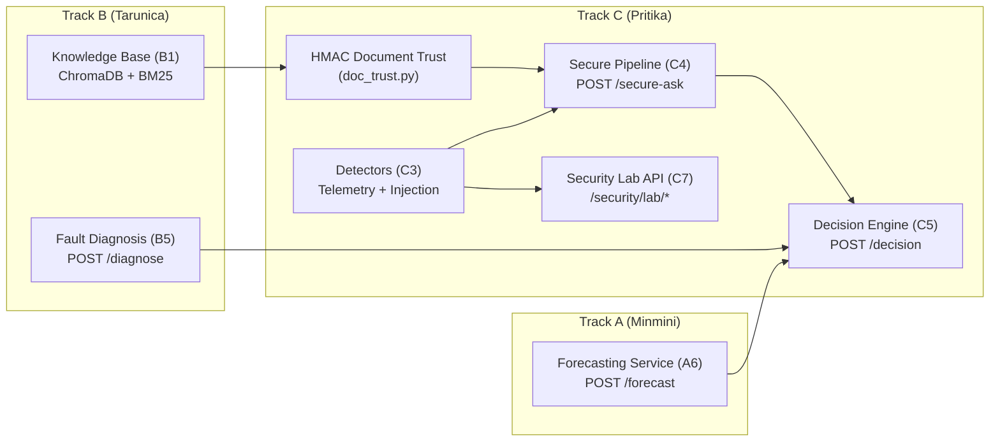

# Track C: Security, Trust & Documentation — Complete File & Module Reference
**Author:** Pritika Kasinathan (`23BIT0232`)  
**Project:** GreenRAG-Sec  
**Repository Location:** `GreenRAG-Sec-pritika/` and `GreenRAG-Sec/` (Track C)

---

## 1. Executive Summary & Track Purpose

In a renewable energy grid assistant, false recommendations or hijacked control loops can lead to physical equipment damage (such as turbine overspeed or transformer overload) or unwarranted shutdowns. **Track C** establishes the security perimeter, attack simulation harness, defense detectors, cryptographic document provenance, and the **trust-aware decision engine**.

The core premise of Track C is:
> **The LLM is strictly an advisor, never an actuator.**  
> An LLM output is merely a *recommendation*. Every recommendation must be independently scored against hard operational constraints, cryptographic document validity, and empirical statistical bounds before reaching an `ACCEPT`, `REVIEW`, or `REJECT` decision.

---

## 2. System Interconnections & Architectural Dependencies

Track C does not exist in isolation; it hardens the outputs from Track A and Track B and interfaces with the shared backend:

- **Tarunica's Modules (Track B):** The secure pipeline (`src/backend/security/secure_pipeline.py`) wraps Tarunica's hybrid retriever (`hybrid_retriever.py`). Retrieved chunks are intercepted and validated against Pritika's HMAC registry (`doc_trust.py`) before entering the LLM prompt.
- **Minmini's Modules (Track A):** The decision engine (`src/backend/trust/decision.py`) takes forecast intervals from Minmini's forecasting service (`service.py`) and evaluates whether the telemetry detector (`scada_anomaly.py`) verified the input data.
- **Shared API (`shared/src/backend/`):** Exposes `POST /secure-ask` and `POST /decision`. The application orchestrator (`orchestrator.py`) invokes Track C's pipeline when operating in **Configuration F (Full GreenRAG-Sec with Trust Engine)**.

---

## 3. Detailed Documentation Guide (`docs/`)

This directory contains the design specifications, threat analysis, and operational guides for Track C:

### 1. [`docs/threat_model.md`](file:///c:/Users/priti/Desktop/greenrag_cloud_project/GreenRAG-Sec-pritika/docs/threat_model.md) (C1 Phase)
- **What it is:** A comprehensive security matrix documenting **30 distinct threats across 8 operational layers**:
  1. *IoT / SCADA Layer* (SC-1 to SC-4): False data injection, sensor replay, logbook tampering, missing data exploits.
  2. *Ingestion Layer* (IN-1 to IN-4): Poisoned manuals, altered chunk hashes, indirect prompt injections in logs.
  3. *Cloud & Supply Chain Layer* (CL-1 to CL-3): Embedding model substitution, untrusted dependency downloads.
  4. *RAG & Retrieval Layer* (RG-1 to RG-5): Keyword stuffing, sibling expansion leakage, retrieval starvation.
  5. *LLM / Generation Layer* (LM-1 to LM-5): Direct prompt injection, jailbreaks, hallucinated safety bypasses.
  6. *Decision Engine Layer* (DE-1 to DE-4): Threshold gaming, client-side decision tampering, weight manipulation.
  7. *API & Serving Layer* (AP-1 to AP-3): Unauthenticated execution, denial of service, parameter manipulation.
  8. *Operator & Human-in-the-Loop Layer* (OP-1 to OP-2): Operator fatigue, rubber-stamping review suggestions.
- **Why it matters:** Establishes the baseline vulnerability landscape and determines which mitigations are implemented vs. left as future work.

### 2. [`docs/attack_simulation.md`](file:///c:/Users/priti/Desktop/greenrag_cloud_project/GreenRAG-Sec-pritika/docs/attack_simulation.md) (C2 Phase)
- **What it is:** Specification of the attack harness used to evaluate undefended GreenRAG.
- **What it covers:**
  - *Telemetry Attacks:* 5 attacks on Solar Plants 1 & 2 and Wind T1 (irradiation bias, module temperature spikes, 50% power attenuation, exact telemetry replay).
  - *Knowledge Base Poisoning:* 9 malicious documents added (e.g. bypassing safety chains, forging maintenance logs for Event 73).
  - *Prompt Injections:* 66 query template injections and 15 held-out novel phrasing styles.

### 3. [`docs/detectors.md`](file:///c:/Users/priti/Desktop/greenrag_cloud_project/GreenRAG-Sec-pritika/docs/detectors.md) (C3 Phase)
- **What it is:** Design and operational manual for the 4 security detector subsystems:
  1. *SCADA Anomaly & Telemetry Spoofing Detector:* Physical plausibility bounds, max rate of change, cross-sensor consistency (DC power vs. solar irradiance), Mahalanobis multivariate distance, and lag-autocorrelation replay checks.
  2. *Prompt Injection Detector:* Dual-phase regex and heuristic pattern detector testing for roleplay escapes, instruction overrides, and delimiter manipulation.
  3. *HMAC Document Trust Verifier:* Cryptographic verification confirming chunk membership in an offline-compiled build manifest.
  4. *Evidence Filter:* Logic for stripping untrusted chunks and selecting fallback responses when evidence is contaminated.

### 4. [`docs/secure_retrieval.md`](file:///c:/Users/priti/Desktop/greenrag_cloud_project/GreenRAG-Sec-pritika/docs/secure_retrieval.md) (C4 Phase)
- **What it is:** End-to-end architecture of the hardened RAG pipeline:
  $$\text{Query} \to \text{Input Sanitizer} \to \text{Injection Detector} \to \text{Hybrid Retriever} \to \text{Document Trust} \to \text{Evidence Filter} \to \text{LLM}$$
- **Key Details:** Explains why evaluation was conducted with `llama3.2:3b` and `qwen2.5:7b-instruct`, details the `SecurityReport` telemetry metadata attached to every API response, and explains fail-closed registry mechanics.

### 5. [`docs/decision_engine.md`](file:///c:/Users/priti/Desktop/greenrag_cloud_project/GreenRAG-Sec-pritika/docs/decision_engine.md) (C5 Phase)
- **What it is:** Mathematical formulation and decision policy governing the Trust Engine.
- **Core Formula:**
  $$T = 0.35E + 0.15R + 0.30C + 0.20S$$
  - Details the hard operational constraints: `no_unsafe_directive`, `claims_cite_trusted_evidence`, and `high_severity_needs_strong_evidence`.
  - Explains the sensitivity analysis testing **969 distinct weight combinations**.

### 6. [`docs/security_evaluation.md`](file:///c:/Users/priti/Desktop/greenrag_cloud_project/GreenRAG-Sec-pritika/docs/security_evaluation.md) (C6 Phase)
- **What it is:** Final evaluation report measuring the deployed `qwen2.5:7b-instruct` model across three configurations: (a) Undefended, (b) Secure Pipeline, and (c) Secure Pipeline + Decision Engine.

### 7. [`docs/team/pritika_security_trust.md`](file:///c:/Users/priti/Desktop/greenrag_cloud_project/GreenRAG-Sec-pritika/docs/team/pritika_security_trust.md)
- **What it is:** Track summary document including viva defense questions, demo scripts, honest system limitations, and exact measured figures.

### 8. [`docs/screenshots/`](file:///c:/Users/priti/Desktop/greenrag_cloud_project/GreenRAG-Sec-pritika/docs/screenshots) (Console Screenshots)
- `01_assistant_numeric.png`: Visual verification of the Assistant answering numeric queries with exact match and trust badge.
- `02_forecast_interval.png`: Forecast dashboard displaying 90% CQR confidence intervals with observed overlays.
- `03_fault_diagnosis.png`: Fault diagnosis dashboard showing event cause attribution, severity, and cited chunk cards.
- `04_security_lab.png`: Security Lab interface demonstrating real-time telemetry replay attacks and detector flags.
- `05_results_status.png`: Results page proving dynamic reflection of all benchmark metrics.

---

## 4. Experimentation Harnesses (`experiments/`)

The Python scripts in this folder reproduce every empirical number cited in the project without guesswork:

1. **[`experiments/attack_simulation.py`](file:///c:/Users/priti/Desktop/greenrag_cloud_project/GreenRAG-Sec-pritika/experiments/attack_simulation.py) (C2 Experiment):**  
   Runs the synthetic attack suite against undefended GreenRAG. Injects telemetry faults into solar/wind data, inserts poisoned documents into the ChromaDB index, and submits prompt injection payloads.
2. **[`experiments/detector_evaluation.py`](file:///c:/Users/priti/Desktop/greenrag_cloud_project/GreenRAG-Sec-pritika/experiments/detector_evaluation.py) (C3 Experiment):**  
   Evaluates the telemetry detector, injection detector, and document trust verifier independently against clean vs. attacked fixtures to compute True Positive Rates (TPR) and False Positive Rates (FPR).
3. **[`experiments/secure_pipeline_eval.py`](file:///c:/Users/priti/Desktop/greenrag_cloud_project/GreenRAG-Sec-pritika/experiments/secure_pipeline_eval.py) (C4 Experiment):**  
   Evaluates the full pipeline end-to-end across clean and poisoned KBs. Proves that poisoned documents are stripped before reaching the context window.
4. **[`experiments/decision_engine_eval.py`](file:///c:/Users/priti/Desktop/greenrag_cloud_project/GreenRAG-Sec-pritika/experiments/decision_engine_eval.py) (C5 Experiment):**  
   Tests the trust formula across diverse recommendation fixtures and runs a 969-point grid sweep over weights ($w_E, w_R, w_C, w_S$) and threshold sensitivity.
5. **[`experiments/security_evaluation.py`](file:///c:/Users/priti/Desktop/greenrag_cloud_project/GreenRAG-Sec-pritika/experiments/security_evaluation.py) (C6 Experiment):**  
   Executes the large-scale evaluation using the deployed `qwen2.5:7b-instruct` model across 330 capture runs and 990 held-out injection trials.
6. **[`experiments/security_evaluation_report.py`](file:///c:/Users/priti/Desktop/greenrag_cloud_project/GreenRAG-Sec-pritika/experiments/security_evaluation_report.py):**  
   Compiles raw JSON/CSV outputs into final markdown summaries (`c6_summary.md`), computing Wilson score intervals for all proportions.

---

## 5. Backend Implementation Modules (`src/backend/`)

This directory contains the production Python logic powering the security and trust services:

### 1. `src/backend/api/lab.py`
- Implements the FastAPI router for the **Security Lab**. Exposes:
  - `GET /security/lab/catalogue`: Enumerates available synthetic attacks (telemetry, injection, poisoning).
  - `POST /security/lab/telemetry`: Runs telemetry attacks against live sensors and returns clean vs. attacked metrics.
  - `POST /security/lab/injection`: Tests prompt injection payloads against the detector.
  - `POST /security/lab/poisoning`: Demonstrates how HMAC verification prevents poisoned KB documents from being trusted.

### 2. `src/backend/security/`
- **`attacks.py`:** Contains class definitions for synthetic attack fixtures: `TelemetryAttack`, `PromptInjectionAttack`, and `PoisoningAttack`.
- **`attack_eval.py`:** Helper routines measuring degradation caused by attacks (e.g. increase in MAE, loss of prediction interval coverage).
- **`auth.py`:** Authentication stub. Records the architectural decision that token-based auth was excluded from the local prototype scope.
- **`scada_anomaly.py`:** Mathematical implementation of the 5-point telemetry detector. Computes inter-sensor Pearson residuals and Mahalanobis distances using covariance matrices fitted exclusively on clean training days.
- **`injection_detector.py`:** Production prompt injection screener. Employs regex rules for delimiter manipulation, jailbreak tokens, and directive overrides. Returns boolean detection flags and likelihood scores.
- **`injection_eval_set.py`:** Curated dataset of 15 held-out prompt injection variants and 15 benign technical questions to test generalization beyond known templates.
- **`doc_trust.py`:** Cryptographic registry verifier. Loads `trust_registry.json`, computes HMAC-SHA256 signatures over chunk content, and drops any chunk whose hash is missing or mismatched.
- **`evidence_filter.py`:** Filters retrieved document lists, ensuring only trusted chunks pass to context generation. Activates extractive fallback when all evidence is untrusted.
- **`secure_pipeline.py`:** Assembles all stages into `SecureRAGPipeline`, returning structured `SecureAnswer` responses with attached `SecurityReport` metadata.

### 3. `src/backend/trust/`
- **`decision.py`:** Core `DecisionEngine` class implementing $T = w_E E + w_R R + w_C C + w_S S$ along with hard and soft operational constraint checkers.
- **`signals.py`:** Translates raw pipeline outputs (`DiagnosisReport`, `SecureAnswer`, `ForecastResponse`) into normalized numeric trust signals ($E, R, C, S$).
- **`service.py`:** FastAPI service layer handling request adaptation and enforcing that recommendations are computed server-side rather than accepted from untrusted client requests.

---

## 6. Comprehensive Results Breakdown (`results/`)

### A. Report Artifacts
- **[`results/report_facts.md`](file:///c:/Users/priti/Desktop/greenrag_cloud_project/GreenRAG-Sec-pritika/results/report_facts.md):** Consolidated statement of verified system facts (redacted of personal data in student export).
- **[`results/report_facts2.md`](file:///c:/Users/priti/Desktop/greenrag_cloud_project/GreenRAG-Sec-pritika/results/report_facts2.md):** Secondary technical fact sheet covering model versions and runtime environments.
- **[`results/report_numbers.md`](file:///c:/Users/priti/Desktop/greenrag_cloud_project/GreenRAG-Sec-pritika/results/report_numbers.md):** Master index of every numerical metric in the project, tracing every number to its origin file.

### B. Security Evaluation Files (`results/security/`) — 46 Files
- **C2 Attack Simulation:**
  - `c2_attack_docs.jsonl`: Synthetic attack documents injected into the knowledge base.
  - `c2_fault_detection.csv` & `c2_forecast.csv`: Degradation metrics across fault detection and forecasting under attack.
  - `c2_knowledge.csv` & `c2_knowledge_items.csv`: LLM answer accuracy and injection obedience rates under attack.
  - `c2_knowledge_raw.jsonl`: Full generated text outputs from `qwen2.5:7b-instruct` under attack.
  - `c2_knowledge_llama3.2-3b.csv` & `c2_knowledge_raw_llama3.2-3b.jsonl`: Baseline evaluation runs using LLaMA.
  - `c2_manifest.json`: Cryptographic manifest of all synthetic attack artifacts.
  - `c2_summary.md`: Markdown summary proving undefended GreenRAG obeys 37/66 prompt injections and suffers significant telemetry distortion.
- **C3 Detector Benchmarks:**
  - `c3_telemetry_days.csv`: Performance of the 5-point telemetry detector across 60 attacked and clean days.
  - `c3_injection.csv`: Evaluation of the prompt injection detector against standard and held-out phrasings.
  - `c3_trust_docs.csv` & `c3_trust_contexts.csv`: Chunk-by-chunk cryptographic verification logs.
  - `c3_filter_items.csv` & `c3_filter_scored.csv`: Evidence filtering efficiency logs.
  - `c3_summary.md`: Summary proving 100% detection of exact telemetry replays, 17/17 detection of tampered docs, and 66/66 detection of template injections.
- **C4 Secure Pipeline Trials:**
  - `c4_raw_none.jsonl` & `c4_run_none.json`: Pure pipeline filtering metrics evaluated without an LLM.
  - `c4_raw_llama3.2-3b.jsonl` & `c4_run_llama3.2-3b.json`: End-to-end secure pipeline generations.
  - `c4_summary.md`: Proves zero attack documents reached the LLM context and clean utility was 100% preserved.
- **C6 Deployed Security Evaluation:**
  - `c6_attack_success.json`: Attack success rates across undefended, secure, and secure+decision engine configurations.
  - `c6_heldout_items.csv` & `c6_heldout_raw_qwen2.5-7b-instruct.jsonl`: Evaluation logs across 990 trials of novel held-out injection attacks.
  - `c6_injection_defence.json`: Injection mitigation rates.
  - `c6_judgements.jsonl`: LLM-as-a-judge evaluation logs.
  - `c6_secure_answers_qwen2.5-7b-instruct.jsonl`: Clean generated answers under the secure pipeline.
  - `c6_sensitivity_grid.csv`, `c6_sensitivity_floors.csv`, `c6_sensitivity_thresholds.csv`: Comprehensive parameter sweeps.
  - `c6_telemetry_days.csv` & `c6_telemetry_rerun_metrics.csv`: Telemetry defense logs.
  - `c6_utility.json`: Quantitative proof that security checks added only 7.7 ms latency without harming faithfulness.
  - `c6_summary.md`: Final authoritative evaluation summary.

### C. Trust & Decision Engine Results (`results/trust/`) — 9 Files
- `c5_decisions.csv`: Log of decisions across all 110 diagnosis events and 66 RAG queries.
- `c5_raw_llama3.2-3b.jsonl` & `c5_run.json`: Raw engine execution outputs.
- `c5_sensitivity_grid.csv` & `c5_sensitivity_thresholds.csv`: 969-point weight sweep proving engine stability.
- `c5_unsafe_constraint_c2.csv`: Log showing that hard constraints successfully intercept unsafe procedure directives.
- `c5_weight_sweep.csv` & `c5_weight_sweep.png`: Visual sensitivity plot demonstrating decision stability across weight variations.
- `c5_summary.md`: Authoritative summary of the Decision Engine's performance.

---

## 7. Comprehensive Test Suite Breakdown (`tests/`)

Every module in Track C is backed by unit and integration tests that run locally in pytest without external dependencies:

| Test File | Modules Tested | Key Assertions & Scenarios Verified |
|---|---|---|
| **[`test_threat_model.py`](file:///c:/Users/priti/Desktop/greenrag_cloud_project/GreenRAG-Sec-pritika/tests/test_threat_model.py)** | `docs/threat_model.md` | Verifies threat IDs are unique, all 8 layers are covered, and mitigations map to existing code. |
| **[`test_attacks.py`](file:///c:/Users/priti/Desktop/greenrag_cloud_project/GreenRAG-Sec-pritika/tests/test_attacks.py)** | `src/backend/security/attacks.py` | Verifies synthetic attack generation (spikes, bias, power drop, prompt injection templates). |
| **[`test_detectors.py`](file:///c:/Users/priti/Desktop/greenrag_cloud_project/GreenRAG-Sec-pritika/tests/test_detectors.py)** | `scada_anomaly.py`, `injection_detector.py`, `doc_trust.py` | Tests telemetry physics checks, injection blocking, and HMAC registry verification. |
| **[`test_secure_pipeline.py`](file:///c:/Users/priti/Desktop/greenrag_cloud_project/GreenRAG-Sec-pritika/tests/test_secure_pipeline.py)** | `src/backend/security/secure_pipeline.py` | Validates end-to-end flow: input sanitization, injection blocking, and evidence filtering. |
| **[`test_secure_api.py`](file:///c:/Users/priti/Desktop/greenrag_cloud_project/GreenRAG-Sec-pritika/tests/test_secure_api.py)** | `POST /secure-ask`, `src/backend/api/lab.py` | Tests FastAPI routes with TestClient; asserts correct HTTP status codes and `SecurityReport` payloads. |
| **[`test_decision_engine.py`](file:///c:/Users/priti/Desktop/greenrag_cloud_project/GreenRAG-Sec-pritika/tests/test_decision_engine.py)** | `src/backend/trust/decision.py`, `signals.py` | Validates trust math ($T$), weight validation, floor rules, and hard constraint rejections. |
| **[`test_security_evaluation.py`](file:///c:/Users/priti/Desktop/greenrag_cloud_project/GreenRAG-Sec-pritika/tests/test_security_evaluation.py)** | `experiments/security_evaluation.py` | Tests reporting calculation routines, Wilson interval math, and metrics compilation. |

---

## 8. Summary of Honest Limitations (Viva Ready)

1. **Missed Held-Out Injections:** While standard template injections were blocked 66/66, the regex detector blocked 11/15 held-out phrasings. In 51 out of 219 accepted answers, the model obeyed instructions because the constraint check was keyword-based rather than semantic.
2. **Offline Telemetry Gating:** The telemetry detector operates on day-long batches offline; it is not yet wired as a millisecond-level streaming gate into the live `/forecast` endpoint.
3. **Farm A Detector Near Chance:** The Wind Farm A fault detector has an AUC 95% CI of $[0.500, 0.950]$ which touches chance ($0.50$). Consequently, confidence $C = 0.0$, meaning **no diagnosis is ever accepted automatically**—all are sent to human review.
4. **Synthetic Attacks:** All evaluated attacks were synthetically generated by the project authors; no live external red-teaming was conducted.
