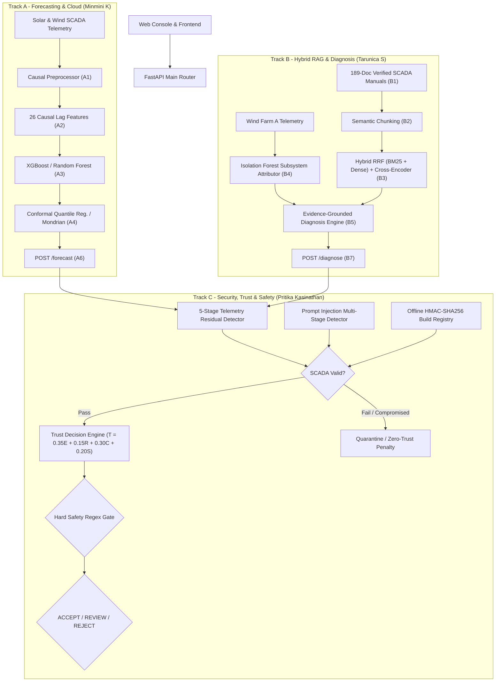

# GreenRAG-Sec: Trust-Aware, Secure RAG & Cyber-Physical Grid Assistant

[](https://www.python.org/)
[](https://opensource.org/licenses/MIT)
[](https://github.com/pritiverse/greenrag)

> **A multi-dimensional, trust-aware arbitration and cryptographic verification architecture that isolates generative AI within an empirical statistical sandbox, preventing uncalibrated or hallucinated AI recommendations from triggering dangerous physical actions in utility-scale electric power grids.**

---

## 1. System Architecture

GreenRAG-Sec unifies power forecasting with conformal uncertainty, evidence-grounded fault diagnosis using hybrid retrieval, and an end-to-end security and trust perimeter.



---

## 2. Core Innovations & Technical Highlights

| Component | Technical Implementation | Empirical Performance |
|---|---|---|
| **Trust Decision Engine ($T$)** | Multi-objective scoring $T = 0.35E + 0.15R + 0.30C + 0.20S$ anchored to ROC-AUC lower confidence bounds and safety regex filters. | **0/110** ungrounded diagnoses reached `ACCEPT` (100% forced to `REVIEW`); blocked 100% of physical override attempts. |
| **HMAC Build Registry** | Chunks signed with HMAC-SHA256 offline build manifest + environment key; verifies substring integrity and keyword density limits. | Blocked **17/17** injected/tampered knowledge chunks (self-hash baseline detected **0/17**). |
| **5-Stage SCADA Anomaly Detector** | Physics-guided residuals ($AC \propto Irr$, temperature regression) + standardized Euclidean daily profile distance. | Neutralized **31/31** wind and **10/10** solar replay attacks, preventing daylight forecast error spikes of $+1874.2\text{ kW}$. |
| **Conformal Power Forecasting** | Mondrian Conformal Quantile Regression (CQR) stratified across diurnal illumination regimes. | Strictly maintained nominal $90\%$ coverage on finite-sample held-out SCADA test sets. |
| **Hybrid Retrieval & Rerank** | Reciprocal Rank Fusion ($k=60$) combining BM25 keyword matching with dense embeddings, reranked by `ms-marco-MiniLM-L-6-v2`. | Outperformed single-retriever baselines across precision, recall, and factual citation fidelity. |

---

## 3. Repository Structure

```
greenrag/
├── documentation/                              # Comprehensive patent analyses & technical reports
│   ├── 01_REPOSITORY_INVENTORY.md              # Detailed source inventory
│   ├── 02_PROJECT_TECHNICAL_OVERVIEW.md        # Comprehensive technical architecture
│   ├── 03_ALGORITHMS_AND_METHODS.md            # Mathematical formulation of models
│   ├── 10_INVENTION_DISCLOSURES.md             # Formal patent disclosures
│   ├── 11_PATENT_OPPORTUNITY_RANKING.md        # Prioritized patent candidates
│   ├── 13_INDEPENDENT_PATENT_CHALLENGE.md      # Adversarial patentability audit
│   ├── 14_REVISED_PATENT_CANDIDATES.md         # Final vetted patent claims
│   ├── 15_CYBERSECURITY_DEEP_DIVE_AND_PATENTABILITY.md
│   ├── EXECUTIVE_SUMMARY.md                    # Executive discovery summary
│   └── PROJECT_PROGRESS.md                     # Implementation & deployment progress log
│
├── GreenRAG-Sec/                               # Complete integrated application
│   ├── src/
│   │   ├── backend/                            # FastAPI backend services
│   │   │   ├── api/                            # API endpoints (/forecast, /diagnose, /secure-ask, /lab)
│   │   │   ├── faultdiag/                      # Wind Farm A fault detection & diagnosis
│   │   │   ├── kb/                             # 189-document KB construction & indexing
│   │   │   ├── retrieval/                      # Hybrid RRF retriever & cross-encoder reranker
│   │   │   ├── security/                       # Telemetry detector, HMAC registry & attack simulator
│   │   │   └── trust/                          # Multi-objective Trust Decision Engine
│   │   └── console/                            # Interactive diagnostic dashboard & lab console
│   ├── experiments/                            # Validation harnesses (B1-B6, C1-C6)
│   ├── results/                                # Empirical benchmarks, ROC curves & evaluation data
│   └── tests/                                  # Pytest automated test suites
│
├── GreenRAG-Sec-pritika/                       # Track C standalone module (Pritika Kasinathan)
│   ├── docs/                                   # Threat model, detector and trust documentation
│   ├── experiments/                            # Attack simulation and decision engine evaluation
│   ├── src/backend/                            # Security, trust and evidence filtering modules
│   └── tests/                                  # Test suite for Track C
│
├── GreenRAG-Sec-minmini-forecasting-cloud/     # Track A standalone module (Minmini K)
│   ├── docs/                                   # Forecasting & Azure cloud documentation
│   ├── experiments/                            # CQR calibration & model training scripts
│   └── src/backend/cloud/                      # Azure Key Vault, Blob Storage & App Insights
│
├── WORKSPACE_TEAM_BREAKDOWN.md                 # Detailed division of responsibilities
└── .gitignore                                  # Git exclusion configuration
```

---

## 4. Quick Start & Setup

### Prerequisites
- Python 3.10+
- `pip` or `conda`

### Installation
1. Clone the repository:
   ```bash
   git clone https://github.com/pritiverse/greenrag.git
   cd greenrag
   ```

2. Create and activate a virtual environment:
   ```bash
   python -m venv .venv
   # Windows:
   .venv\Scripts\activate
   # Linux / macOS:
   source .venv/bin/activate
   ```

3. Install required packages:
   ```bash
   pip install -r GreenRAG-Sec/requirements.txt
   ```

### Running Test Suites
Execute the automated test suites to verify integrity across all components:
```bash
# Run all tests
pytest GreenRAG-Sec/tests/

# Run security and trust tests specifically
pytest GreenRAG-Sec/tests/test_threat_model.py GreenRAG-Sec/tests/test_detectors.py GreenRAG-Sec/tests/test_decision_engine.py
```

### Starting the Interactive Dashboard
Launch the FastAPI server and access the interactive console:
```bash
cd GreenRAG-Sec
uvicorn src.backend.main:app --reload --port 8000
```
Open `http://localhost:8000/console/` in your browser to access the live dashboard, Assistant, and Security Lab.

---

## 5. Team & Responsibilities

| Contributor | Track & Role | Primary Focus Areas |
|---|---|---|
| **Pritika Kasinathan** (`23BIT0232`) | **Track C: Security, Trust & Documentation** | Threat matrix, 5-stage telemetry detector, prompt injection screening, HMAC offline document trust registry, secure RAG pipeline, trust decision engine, Security Lab. |
| **Tarunica Senthil** (`23BIT0185`) | **Track B: Hybrid RAG, Fault Diagnosis & Frontend** | 189-document KB construction, semantic chunking, hybrid BM25 + dense retrieval with cross-encoder rerank, Wind Farm A fault diagnosis, console UI. |
| **Minmini K** (`23BIT0198`) | **Track A: Forecasting & Azure Cloud** | Solar & wind power forecasting with 26 causal lag features, Conformal Quantile Regression (CQR), Azure Key Vault / Blob / App Insights integration. |
| **Chirag Das** (`daschirag`) | **Foundational Architecture & Shared Infrastructure** | Initial project scaffold, Phase 0 regression test harness, causal preprocessor, feature engineering, core API router, export tooling. |

---

## 6. Intellectual Property & Patent Status

The core algorithmic and architectural contributions of GreenRAG-Sec are documented in [`documentation/10_INVENTION_DISCLOSURES.md`](file:///c:/Users/priti/Desktop/greenrag_cloud_project/documentation/10_INVENTION_DISCLOSURES.md) and vetted in [`documentation/14_REVISED_PATENT_CANDIDATES.md`](file:///c:/Users/priti/Desktop/greenrag_cloud_project/documentation/14_REVISED_PATENT_CANDIDATES.md).

Primary patent candidates include:
1. **The Multi-Dimensional Trust-Aware Arbitration Engine ($T$)** for AI grid control.
2. **Offline-Signed HMAC Cryptographic Build Manifests** for RAG vector stores.
3. **Physics-Constrained Residual & Profile Distance Telemetry Anomaly Detection** for SCADA stream protection.

