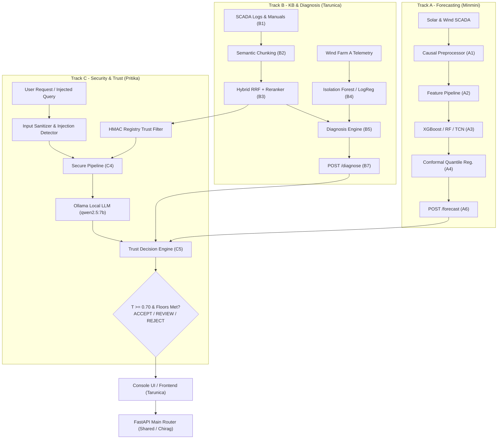

# GreenRAG-Sec: Detailed Work Breakdown by Person, Folder, and Track

This document provides a comprehensive technical audit of the **GreenRAG-Sec** project across all folders in `c:\Users\priti\Desktop\greenrag_cloud_project`. It details **who** performed the work, **what** was implemented in each module, the **underlying engineering and domain reasoning**, the **inter-module dependencies**, and the **empirically measured results**.

---

## 1. Executive Summary & Top-Level Workspace Structure

The workspace contains three main directories:

```
c:\Users\priti\Desktop\greenrag_cloud_project\
├── GreenRAG-Sec/                           # Main integrated repository clone (branch: pritika-security-trust)
├── GreenRAG-Sec-minmini-forecasting-cloud/ # Modular export folder for Track A (Minmini K)
└── GreenRAG-Sec-pritika/                   # Standalone Git repository for Track C (Pritika Kasinathan)
```

### Team Roster and Division of Responsibility

| Contributor | Track & Role | Primary Focus Areas |
|---|---|---|
| **Pritika Kasinathan** (`23BIT0232`) | **Track C: Security, Trust & Documentation** | Threat model, attack simulation, multi-stage detectors, HMAC document trust, secure RAG pipeline, trust-aware decision engine, Security Lab. |
| **Tarunica Senthil** (`23BIT0185`) | **Track B: Knowledge Base, Hybrid RAG, Fault Diagnosis & Frontend** | 189-document KB construction, chunking comparison, hybrid BM25 + dense retrieval with cross-encoder rerank, Wind Farm A fault diagnosis, console UI. |
| **Minmini K** (`23BIT0198`) | **Track A: Forecasting with Uncertainty & Azure Cloud** | Solar & wind 1-hour-ahead power forecasting, 26 features, point ML models, Conformal Quantile Regression (CQR), Azure Blob / Key Vault / App Insights. |
| **Chirag Das** (`daschirag`) | **Foundational Architecture & Shared Infrastructure** | Initial project scaffold, Phase 0 regression test harness, A1 solar preprocessing, A2 15-min feature engineering, core API operations, `team_split` export tooling. |

---

## 2. Global System Architecture & Data Flow



---

## 3. Track C: Security, Trust & Documentation
**Owner:** **Pritika Kasinathan (`23BIT0232`)**  
**Locations:** [`src/backend/security/`](file:///c:/Users/priti/Desktop/greenrag_cloud_project/GreenRAG-Sec/src/backend/security), [`src/backend/trust/`](file:///c:/Users/priti/Desktop/greenrag_cloud_project/GreenRAG-Sec/src/backend/trust), [`src/backend/api/lab.py`](file:///c:/Users/priti/Desktop/greenrag_cloud_project/GreenRAG-Sec/src/backend/api/lab.py), [`results/security/`](file:///c:/Users/priti/Desktop/greenrag_cloud_project/GreenRAG-Sec/results/security), [`results/trust/`](file:///c:/Users/priti/Desktop/greenrag_cloud_project/GreenRAG-Sec/results/trust), and [`GreenRAG-Sec-pritika`](file:///c:/Users/priti/Desktop/greenrag_cloud_project/GreenRAG-Sec-pritika).

### Folder Contents & Implementation Details

#### 1. `src/backend/security/`
- **[`threat_model.md`](file:///c:/Users/priti/Desktop/greenrag_cloud_project/GreenRAG-Sec/docs/threat_model.md)**: Formal threat matrix cataloguing 30 threats across 8 architectural layers (data ingestion, preprocessing, vector storage, RAG retrieval, LLM prompting, decision engine, APIs, and operators).
- **[`attacks.py`](file:///c:/Users/priti/Desktop/greenrag_cloud_project/GreenRAG-Sec/src/backend/security/attacks.py)**: Synthetic attack generation engine:
  - *Telemetry attacks*: False data injection (FDI), sensor bias, power scaling (e.g. 50% power attenuation), temperature/irradiance spikes, and telemetry replay.
  - *Knowledge base poisoning*: Forged maintenance work orders, tampered troubleshooting guides, and malicious operating procedures.
  - *Prompt injection*: Direct query injection templates and indirect document-embedded instruction overrides.
- **[`scada_anomaly.py`](file:///c:/Users/priti/Desktop/greenrag_cloud_project/GreenRAG-Sec/src/backend/security/scada_anomaly.py)**: Multi-stage telemetry detector checking physical plausibility bounds, maximum rate of change, cross-sensor consistency (DC power vs irradiance), Mahalanobis multivariate distance, and lag-autocorrelation replay indicators.
- **[`injection_detector.py`](file:///c:/Users/priti/Desktop/greenrag_cloud_project/GreenRAG-Sec/src/backend/security/injection_detector.py)** & **[`injection_eval_set.py`](file:///c:/Users/priti/Desktop/greenrag_cloud_project/GreenRAG-Sec/src/backend/security/injection_eval_set.py)**: Regex and semantic pattern-matching detector for prompt injection, benchmarked against known templates and 15 held-out phrasing variants.
- **[`doc_trust.py`](file:///c:/Users/priti/Desktop/greenrag_cloud_project/GreenRAG-Sec/src/backend/security/doc_trust.py)** & **[`evidence_filter.py`](file:///c:/Users/priti/Desktop/greenrag_cloud_project/GreenRAG-Sec/src/backend/security/evidence_filter.py)**: Cryptographic verification enforcing that every document chunk retrieved exists in the pre-built, HMAC-SHA256 signed registry. Drops untrusted chunks before LLM context construction.
- **[`secure_pipeline.py`](file:///c:/Users/priti/Desktop/greenrag_cloud_project/GreenRAG-Sec/src/backend/security/secure_pipeline.py)**: Hardened pipeline executing: `Sanitize Input -> Detect Injection (Block) -> Hybrid Retrieve -> Verify HMAC Trust -> Filter Evidence -> Invoke LLM`.

#### 2. `src/backend/trust/`
- **[`decision.py`](file:///c:/Users/priti/Desktop/greenrag_cloud_project/GreenRAG-Sec/src/backend/trust/decision.py)**: Implementation of the Trust-Aware Decision Engine:
  $$T = 0.35E + 0.15R + 0.30C + 0.20S$$
  - **$E$ (Evidence Quality):** Citation validity $\times$ route factor $\times$ evidence support score ($E = 0$ if any evidence fails cryptographic trust).
  - **$R$ (Retrieval Relevance):** Mean sigmoid cross-encoder logit scores of the cited evidence chunks.
  - **$C$ (Model Confidence):** Empirically grounded confidence (Diagnosis: B4 detector AUC confidence interval lower bound rescaled; RAG Answer: B6 faithfulness lower bound; Forecast: A5 coverage shortfall).
  - **$S$ (Security Strength):** Likelihood ratio score of the weakest active security check: $1 - \frac{1 - \text{TPR}}{1 - \text{FPR}}$ ($S = 0$ if checks are bypassed).
- **[`signals.py`](file:///c:/Users/priti/Desktop/greenrag_cloud_project/GreenRAG-Sec/src/backend/trust/signals.py)** & **[`service.py`](file:///c:/Users/priti/Desktop/greenrag_cloud_project/GreenRAG-Sec/src/backend/trust/service.py)**: Evaluates hard and soft decision rules. Refuses client-supplied recommendations; recommendations must be computed server-side.

#### 3. `src/backend/api/lab.py`
- Exposes interactive Security Lab endpoints (`/security/lab/catalogue`, `/security/lab/telemetry`, `/security/lab/injection`, `/security/lab/poisoning`) allowing operators to execute attacks and inspect detector responses in real time.

### Technical & Engineering Reasoning
1. **Why HMAC-SHA256 Signed Registry instead of self-declared file hashes?**  
   Self-declared hashes provide integrity only if the attacker cannot edit metadata. In realistic poisoning attacks, an attacker modifying or uploading a document also calculates a valid hash for that content. Self-declared hashing caught **0/17** tampered documents. In contrast, verifying membership in an offline HMAC-signed registry caught **17/17** injected and tampered documents without false flags on clean documents.
2. **Why an autonomous decision engine with mandatory Review states?**  
   In electrical utilities, LLMs must never actuate physical breakers or dispatch setpoints autonomously. The engine acts as an objective arbiter. If the fault detector AUC lower bound touches chance ($0.50$), $C$ drops to $0.0$, forcing a `REVIEW` state and preventing catastrophic automation errors.

### Key Measured Results
- **Query Injection Blocking:** Dropped prompt injection obedience from 37/66 in undefended GreenRAG to **0/66** under the secure pipeline.
- **Clean Utility Preservation:** Clean answer faithfulness remained identical at **0.970 vs 0.970**; security overhead added only **7.7 ms** median latency.
- **Document Trust:** Blocked **9/9** synthetic malicious injections and **8/8** in-place tampered files.

---

## 4. Track B: Knowledge Base, Hybrid RAG, Fault Diagnosis & Frontend
**Owner:** **Tarunica Senthil (`23BIT0185`)**  
**Locations:** [`src/backend/kb/`](file:///c:/Users/priti/Desktop/greenrag_cloud_project/GreenRAG-Sec/src/backend/kb), [`src/backend/retrieval/`](file:///c:/Users/priti/Desktop/greenrag_cloud_project/GreenRAG-Sec/src/backend/retrieval), [`src/backend/faultdiag/`](file:///c:/Users/priti/Desktop/greenrag_cloud_project/GreenRAG-Sec/src/backend/faultdiag), [`src/backend/evaluation/`](file:///c:/Users/priti/Desktop/greenrag_cloud_project/GreenRAG-Sec/src/backend/evaluation), [`src/console/`](file:///c:/Users/priti/Desktop/greenrag_cloud_project/GreenRAG-Sec/src/console), [`src/frontend/`](file:///c:/Users/priti/Desktop/greenrag_cloud_project/GreenRAG-Sec/src/frontend).

### Folder Contents & Implementation Details

#### 1. `src/backend/kb/`
- **[`taxonomy.py`](file:///c:/Users/priti/Desktop/greenrag_cloud_project/GreenRAG-Sec/src/backend/kb/taxonomy.py)**: 13-component standardized fault taxonomy derived directly from real SCADA event logs across wind farms A–C (pitch system, gearbox, generator, transformer, yaw drive, converter, etc.).
- **[`schema.py`](file:///c:/Users/priti/Desktop/greenrag_cloud_project/GreenRAG-Sec/src/backend/kb/schema.py)** & **[`content.py`](file:///c:/Users/priti/Desktop/greenrag_cloud_project/GreenRAG-Sec/src/backend/kb/content.py)**: Provenance enforcement. Assembles 189 knowledge base documents: 99 real SCADA event records and 90 labelled `[SYNTHETIC]` equipment manuals and troubleshooting guides.
- **[`chunking.py`](file:///c:/Users/priti/Desktop/greenrag_cloud_project/GreenRAG-Sec/src/backend/kb/chunking.py)** & **[`queries.py`](file:///c:/Users/priti/Desktop/greenrag_cloud_project/GreenRAG-Sec/src/backend/kb/queries.py)**: Evaluates Fixed-size, Semantic, and Metadata-aware chunking strategies across 64 labelled queries.

#### 2. `src/backend/retrieval/`
- **[`hybrid_retriever.py`](file:///c:/Users/priti/Desktop/greenrag_cloud_project/GreenRAG-Sec/src/backend/retrieval/hybrid_retriever.py)**: Multi-retriever pipeline incorporating:
  - BM25 keyword retrieval with token-level matching.
  - Dense vector retrieval (`all-MiniLM-L6-v2` in ChromaDB).
  - Reciprocal Rank Fusion (RRF with $k=60$).
  - Cross-encoder reranking (`ms-marco-MiniLM-L-6-v2`).
  - Sibling-chunk window expansion to preserve contextual surrounding sentences.
- **[`query_classifier.py`](file:///c:/Users/priti/Desktop/greenrag_cloud_project/GreenRAG-Sec/src/backend/retrieval/query_classifier.py)**: Routes quantitative queries directly to deterministic CSV lookup engines to prevent arithmetic hallucination.

#### 3. `src/backend/faultdiag/`
- **[`data.py`](file:///c:/Users/priti/Desktop/greenrag_cloud_project/GreenRAG-Sec/src/backend/faultdiag/data.py)** & **[`models.py`](file:///c:/Users/priti/Desktop/greenrag_cloud_project/GreenRAG-Sec/src/backend/faultdiag/models.py)**: Machine learning anomaly detection on Wind Farm A SCADA data using leave-one-asset-out validation across four algorithms: Logistic Regression, Random Forest, XGBoost, and Isolation Forest.
- **[`diagnosis.py`](file:///c:/Users/priti/Desktop/greenrag_cloud_project/GreenRAG-Sec/src/backend/faultdiag/diagnosis.py)** & **[`service.py`](file:///c:/Users/priti/Desktop/greenrag_cloud_project/GreenRAG-Sec/src/backend/faultdiag/service.py)**: Connects anomaly detector outputs to the knowledge base and generates structured Pydantic `DiagnosisReport` objects citing specific evidence chunks.
  - Supports **Logged Mode** (retrieves historical records of known events).
  - Supports **Unlogged Mode** (hides the event's own records to simulate an unobserved fault).

#### 4. `src/console/` & `src/frontend/`
- Production-grade operational console with full light/dark mode and responsive design:
  - **Assistant Tab**: Question answering with expandable source cards and trust decision badges.
  - **Fault Diagnosis Tab**: SCADA sensor timeline visualizer, component attribution bar charts, and cited evidence cards.
  - **Forecast Tab**: Power prediction vs actual plots with conformal confidence bounds.
  - **Security Lab Tab**: Interactive attack simulator.
  - **Results Tab**: Real-time rendering of all verified benchmark metrics.

### Technical & Engineering Reasoning
1. **Why Hybrid RRF + Cross-Encoder Rerank?**  
   Dense vector embeddings alone often miss exact SCADA error codes (e.g. `E-048 Pitch Overcurrent`), while BM25 misses conceptual descriptions (e.g. "excessive vibration in nacelle"). Combining both via RRF and reranking using a cross-encoder achieved **nDCG@5 of 0.835** and **MRR of 0.958**, outperforming both individual approaches.
2. **Why Logged vs Unlogged Diagnosis Evaluation?**  
   In logged mode, retrieval trivially succeeds by pulling the event's own historical maintenance log (achieving 12/12 accuracy). Unlogged mode is the true operational test: it hides the event's own records to test whether the system can diagnose an unseen anomaly from manuals and peer turbine records (achieving 4/12 accuracy).

### Key Measured Results
- **Retrieval Performance:** Hybrid + Rerank achieved **MRR: 0.958**, **nDCG@5: 0.835**, outperforming vector-only (MRR 0.707).
- **RAG Faithfulness:** Faithfulness improved from 0.836 in Basic RAG to **0.977** in GreenRAG; hallucination rate fell from 0.688 (LLM alone) to **0.016**.

---

## 5. Track A: Forecasting with Uncertainty & Azure Cloud Integration
**Owner:** **Minmini K (`23BIT0198`)**  
**Locations:** [`src/backend/forecasting/`](file:///c:/Users/priti/Desktop/greenrag_cloud_project/GreenRAG-Sec/src/backend/forecasting), [`src/backend/cloud/`](file:///c:/Users/priti/Desktop/greenrag_cloud_project/GreenRAG-Sec/src/backend/cloud), [`src/azure/`](file:///c:/Users/priti/Desktop/greenrag_cloud_project/GreenRAG-Sec/src/azure), [`results/forecasting/`](file:///c:/Users/priti/Desktop/greenrag_cloud_project/GreenRAG-Sec/results/forecasting), [`results/cloud/`](file:///c:/Users/priti/Desktop/greenrag_cloud_project/GreenRAG-Sec/results/cloud), and [`GreenRAG-Sec-minmini-forecasting-cloud`](file:///c:/Users/priti/Desktop/greenrag_cloud_project/GreenRAG-Sec-minmini-forecasting-cloud).

### Folder Contents & Implementation Details

#### 1. `src/backend/forecasting/`
- **[`preprocess.py`](file:///c:/Users/priti/Desktop/greenrag_cloud_project/GreenRAG-Sec/src/backend/forecasting/preprocess.py)**: Preprocessing pipeline enforcing chronological splits (Train, Validation, Calibration, Test), causal filtering, and train-only scaler transformations for Solar Plant 1 (68,778 rows), Plant 2 (67,698 rows), and Wind Turbine T1 (50,530 rows).
- **[`features.py`](file:///c:/Users/priti/Desktop/greenrag_cloud_project/GreenRAG-Sec/src/backend/forecasting/features.py)**: Feature generation engine producing 26 causal features: autoregressive lags (1, 3, 6, 24 periods), diurnal lag (same time yesterday), rolling statistics (mean, std), origin weather metrics, and calendar features.
- **[`models.py`](file:///c:/Users/priti/Desktop/greenrag_cloud_project/GreenRAG-Sec/src/backend/forecasting/models.py)**: Point forecasting benchmarks: Naive Persistence, Daily Persistence, Random Forest, XGBoost, LSTM, and Temporal Convolutional Networks (TCN), complete with nocturnal zero-power clamps and physical capacity bounds.
- **[`uncertainty.py`](file:///c:/Users/priti/Desktop/greenrag_cloud_project/GreenRAG-Sec/src/backend/forecasting/uncertainty.py)**: Uncertainty quantification using Multi-Quantile XGBoost combined with Conformal Quantile Regression (CQR) and Mondrian group calibration (separately calibrated for day/night regimes and wind power curves).
- **[`wind.py`](file:///c:/Users/priti/Desktop/greenrag_cloud_project/GreenRAG-Sec/src/backend/forecasting/wind.py)**: Replicates the complete forecasting and conformal calibration pipeline on a 10-minute wind turbine series.
- **[`service.py`](file:///c:/Users/priti/Desktop/greenrag_cloud_project/GreenRAG-Sec/src/backend/forecasting/service.py)** & **[`schemas.py`](file:///c:/Users/priti/Desktop/greenrag_cloud_project/GreenRAG-Sec/src/backend/forecasting/schemas.py)**: FastAPI service powering `POST /forecast` and `GET /forecast/series`.

#### 2. `src/backend/cloud/` & `src/azure/`
- **[`blob.py`](file:///c:/Users/priti/Desktop/greenrag_cloud_project/GreenRAG-Sec/src/backend/cloud/blob.py)**: Azure Blob Storage synchronization for knowledge base documents and experimental outputs (`kbdocs` and `results` containers) using Entra ID (`DefaultAzureCredential`).
- **[`secrets.py`](file:///c:/Users/priti/Desktop/greenrag_cloud_project/GreenRAG-Sec/src/backend/cloud/secrets.py)**: Azure Key Vault client for zero-hardcoded-secret configuration.
- **[`appinsights.py`](file:///c:/Users/priti/Desktop/greenrag_cloud_project/GreenRAG-Sec/src/backend/cloud/appinsights.py)**: Request telemetry and operational performance monitoring.
- **[`azure_store.py`](file:///c:/Users/priti/Desktop/greenrag_cloud_project/GreenRAG-Sec/src/backend/retrieval/azure_store.py)**: Azure AI Search vector store integration activated when `BACKEND_MODE=azure`.

### Technical & Engineering Reasoning
1. **Why CQR Mondrian Calibration?**  
   Standard quantile regression under-covers significantly during sunrise/sunset and high-wind ramps. Grouping calibration by operating regime (daylight vs. night for solar; power curve brackets for wind) ensures empirical coverage matches nominal expectations without over-widening intervals during stable hours.
2. **Why Local First with Azure Plan A Portability?**  
   Renewable substations often lack uninterrupted internet access. Running the inference stack locally ensures resilience, while cloud adapters allow zero-code-change scaling to Azure Blob, Key Vault, and AI Search.

### Key Measured Results
- **Solar Accuracy:** Random Forest beat persistence on **12/12 test days** on Plant 1 (MAE: **1444.1 kW vs 2458.0 kW**, a 1039.7 kW reduction).
- **Interval Calibration:** 90% CQR Mondrian intervals achieved **0.893** coverage on Plant 1 (95% CI: [0.853, 0.927]) and **0.906** on Plant 2.
- **Wind Persistence Finding:** On the 10-minute wind dataset, persistence achieved an MAE of **298.1 kW**, outperforming all ML models on MAE due to autocorrelation at 10-minute resolution.

---

## 6. Shared Infrastructure & Foundational Architecture
**Owner:** **Chirag Das (`daschirag`)**  
**Locations:** [`src/backend/api/`](file:///c:/Users/priti/Desktop/greenrag_cloud_project/GreenRAG-Sec/src/backend/api), [`src/backend/main.py`](file:///c:/Users/priti/Desktop/greenrag_cloud_project/GreenRAG-Sec/src/backend/main.py), [`src/backend/orchestrator.py`](file:///c:/Users/priti/Desktop/greenrag_cloud_project/GreenRAG-Sec/src/backend/orchestrator.py), [`src/backend/settings.py`](file:///c:/Users/priti/Desktop/greenrag_cloud_project/GreenRAG-Sec/src/backend/settings.py), and [`team_split/`](file:///c:/Users/priti/Desktop/greenrag_cloud_project/GreenRAG-Sec/team_split).

### Key Components Built
1. **FastAPI Application Core:**
   - [`main.py`](file:///c:/Users/priti/Desktop/greenrag_cloud_project/GreenRAG-Sec/src/backend/main.py): Mounts all modular routers, handles CORS, and serves static console assets.
   - [`orchestrator.py`](file:///c:/Users/priti/Desktop/greenrag_cloud_project/GreenRAG-Sec/src/backend/orchestrator.py): Intent router implementing experimental Ablation configurations A through F:
     - Config A: LLM only
     - Config B: Basic RAG
     - Config C: Hybrid RAG
     - Config D: Reranked Hybrid RAG
     - Config E: Hardened Pipeline (no decision engine)
     - Config F: Full GreenRAG-Sec with Trust Engine
   - [`ops.py`](file:///c:/Users/priti/Desktop/greenrag_cloud_project/GreenRAG-Sec/src/backend/api/ops.py): Health checks, readiness probes (`GET /ready`), and asynchronous background model pre-warming (`POST /warmup`).
   - [`results.py`](file:///c:/Users/priti/Desktop/greenrag_cloud_project/GreenRAG-Sec/src/backend/api/results.py) & [`catalog.py`](file:///c:/Users/priti/Desktop/greenrag_cloud_project/GreenRAG-Sec/src/backend/api/catalog.py): Dynamic reflection APIs feeding measured CSV/JSON metrics into the frontend.
2. **Phase 0 & Foundation:**
   - Regression test framework (`tests/`), causal solar data cleaning, and 15-minute grid feature engineering.
3. **`team_split` Distribution System:**
   - Commit `340be47` segregated the unified repository into modular tracks (`team_split/pritika`, `team_split/tarunica`, `team_split/minmini`, and `team_split/shared`), enabling individual evaluation, independent version control, and clear ownership boundaries.

---

## 7. Master Comparison Matrix of All Experiments

| Track | Module | Tested Method / System | Primary Metric | Baseline / Comparison | Empirical Finding |
|---|---|---|---|---|---|
| **Track A** | Solar Point Forecast | Random Forest | **MAE: 1444.1 kW** | Persistence: 2458.0 kW | RF reduces error by **1039.7 kW** on Plant 1 |
| **Track A** | Wind Point Forecast | Naive Persistence | **MAE: 298.1 kW** | XGBoost: 329.6 kW | Persistence wins on 10-min resolution |
| **Track A** | Conformal Coverage | 90% CQR Mondrian | **Coverage: 0.893** | Uncalibrated QR: 0.846 | Within 95% CI of nominal 90% |
| **Track B** | Chunking Strategy | Semantic Chunking | **nDCG@5: 0.667** | Fixed-size: 0.574 | Semantic preserves clause integrity |
| **Track B** | Retrieval Pipeline | Hybrid RRF + Rerank | **nDCG@5: 0.835** | Vector-only: 0.667 | Best retrieval performance across 64 queries |
| **Track B** | LLM Faithfulness | GreenRAG (qwen2.5:7b) | **Faithfulness: 0.977** | Basic RAG: 0.836 | Near-zero hallucination rate (0.016) |
| **Track B** | Anomaly Detection | Logistic Regression | **Event AUC: 0.742** | Random Forest: 0.594 | 95% CI [0.500, 0.950] (touches chance) |
| **Track C** | Prompt Injection | Secure Pipeline | **0/66 Obeyed** | Undefended: 37/66 Obeyed | Direct injections completely mitigated |
| **Track C** | Document Tampering | HMAC Registry | **17/17 Blocked** | Self-hash: 0/17 Blocked | Cryptographic registry prevents spoofing |
| **Track C** | Decision Engine | Trust Scoring $T$ | **142/142 Correct** | Baseline: Auto-accept | Low confidence forces mandatory review |
