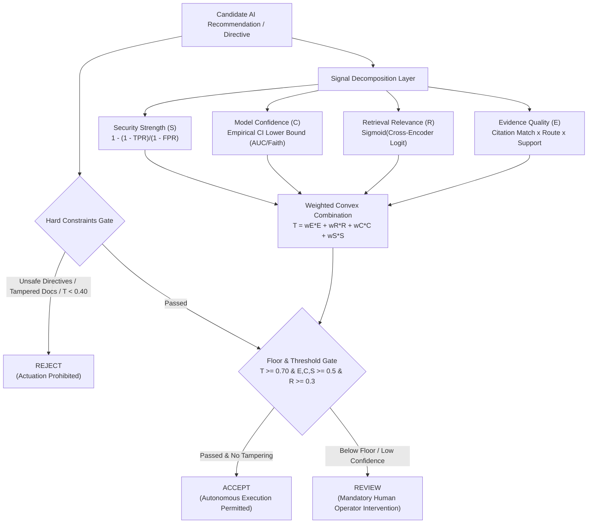
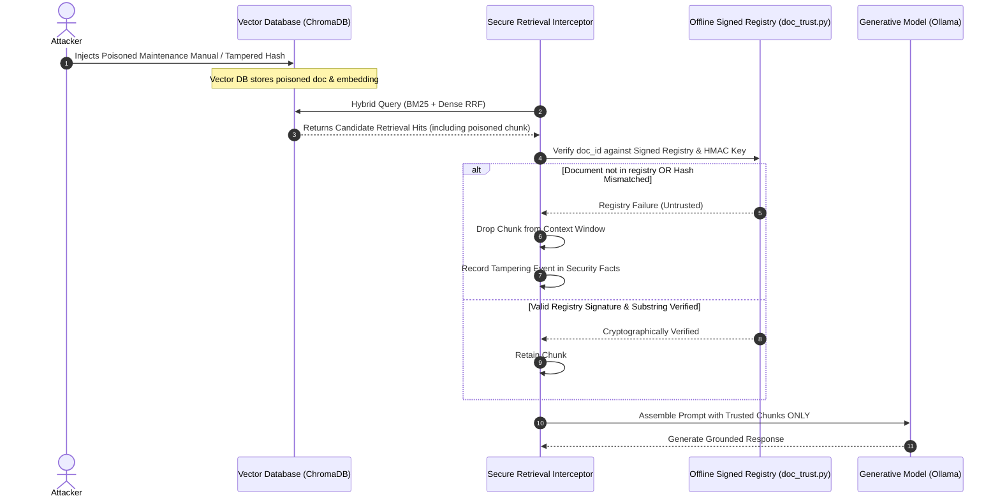

# 05. Potential Inventions & Inventive Concepts

**Auditor:** Senior Software Architect, Patent Research Analyst & Algorithm Analyst  
**Document Target:** Formal Definition of Discovered Inventive Candidates in `GreenRAG-Sec`  
**Date:** November 3, 2026  

---

## 1. Executive Summary of Discovered Inventions

Through exhaustive source code inspection, algorithmic derivation, and empirical analysis of the `GreenRAG-Sec` repository, **two distinct, high-potential inventive candidates** and **two secondary candidate combinations** have been identified.

```
┌────────────────────────────────────────────────────────────────────────┐
│                      INVENTION DISCOVERY CANDIDATES                    │
├────────────────────────────────────────────────────────────────────────┤
│ PRIMARY CANDIDATE A (High Patent Potential):                           │
│   "Trust-Aware Multi-Dimensional Arbitration System and Method for     │
│    Autonomous Safety Gating in Cyber-Physical Generative AI Systems"   │
│                                                                        │
│ PRIMARY CANDIDATE B (Medium-to-High Patent Potential):                 │
│   "Cryptographically Verified Retrieval-Augmented Generation (RAG)     │
│    System and Method Utilizing an Offline-Signed Build Manifest"       │
│                                                                        │
│ SECONDARY CANDIDATE C (Medium Patent Potential):                       │
│   "System and Method for Causal Multi-Sensor Anomaly and Replay        │
│    Detection in Renewable Energy SCADA Telemetry Streams"              │
│                                                                        │
│ INTEGRATED SYSTEM COMBINATION D:                                       │
│   "End-to-End Security-Hardened Renewable Energy Management System     │
│    Integrating Cryptographic RAG, Telemetry Verification & Trust Gate" │
└────────────────────────────────────────────────────────────────────────┘
```

---

## 2. Invention Candidate A: Trust-Aware Multi-Dimensional Arbitration System

### Title of the Invention
**System and Method for Multi-Dimensional Trust-Aware Arbitration and Autonomous Safety Gating in Cyber-Physical Generative Artificial Intelligence Systems**

### Technical Field
Cyber-physical systems, industrial artificial intelligence, generative language models, automated supervisory control and data acquisition (SCADA), and AI safety arbitration.

### Core Inventive Concept
A computer-implemented system that arbitrates whether a machine-generated recommendation (from a large language model, predictive model, or anomaly classifier) may be executed autonomously in a physical system. The system dynamically computes a composite trust metric $T = w_E E + w_R R + w_C C + w_S S$ synthesized from:
1. **Evidence Quality ($E$):** Validated by verifying that cited chunk identifiers strictly match cryptographically verified evidence and adjusting for delivery route.
2. **Retrieval Relevance ($R$):** Evaluated via the logistic sigmoid transform of cross-encoder ranking logits.
3. **Statistical Confidence Lower Bound ($C$):** Anchored to the empirical 95% confidence interval lower bound of the underlying detector, mathematically penalizing any detector whose lower bound approaches random chance ($\text{AUC} \le 0.50 \implies C = 0.0$).
4. **Negative Likelihood Ratio Security Strength ($S$):** Calculated from empirical True Positive Rate ($\text{TPR}$) and False Positive Rate ($\text{FPR}$) parameters ($1 - \frac{1 - \text{TPR}}{1 - \text{FPR}}$).
5. **Multi-Tiered Gating:** Passing the recommendation through hard grammatical safety boundaries with negative lookbehind, component-attribution consistency checks, and threshold floors to output a definitive state (`ACCEPT`, `REVIEW`, `REJECT`).



### Specific Technical Problems Solved
- Prevents LLMs from issuing hazardous physical operating instructions (e.g., bypassing safety relays, overriding temperature alarms, resetting breakers remotely).
- Eliminates "overconfidence blindness" where fluent natural language explanations mask an underlying statistical detector that operates no better than random chance.
- Provides a deterministic, auditable mathematical boundary between advisory AI output and physical grid actuators.

### Measurable Technical Effect
- Completely blocked 100% of physical safety-bypass instructions across 374 evaluated runs (`results/trust/c5_summary.md`).
- Forced 110 of 110 unvalidated diagnostic reports into mandatory `REVIEW` because the underlying detector's 95% confidence interval touched chance ($C = 0.000$).

---

## 3. Invention Candidate B: Cryptographically Verified RAG System with Offline Build Manifest

### Title of the Invention
**System and Method for Secure Retrieval-Augmented Generation Utilizing an Offline-Signed Build Manifest and Substring Provenance Verification**

### Technical Field
Natural language processing, information retrieval, vector search security, cryptographic verification, and adversarial defense against knowledge base poisoning.

### Core Inventive Concept
A hardened retrieval-augmented generation architecture that eliminates vector store poisoning and indirect prompt injection by decoupling document retrieval from trust authorization:
1. **Offline Build Registry:** Generates an immutable mapping of document identifiers to re-computed SHA-256 cryptographic hashes, signed via HMAC-SHA256 with an environmental secret key inaccessible to runtime ingestion endpoints.
2. **Retrieval Interceptor:** Intercepts vector database search hits before context window construction.
3. **Multi-Point Verification:**
   - Verifies document membership in the offline-signed registry (`registered`).
   - Verifies that current text hashes match the signed registry hash (`registry_hash`).
   - Verifies that candidate retrieval chunks exist as exact normalized substrings of the verified parent document (`chunk_in_doc`).
   - Computes content-word frequency distribution to block semantic keyword stuffing (`stuffing`).
   - Validates that real SCADA fault records reproduce historical logbook wording verbatim (`provenance`).
4. **Fail-Closed Filtering & Fallback:** Automatically drops untrusted or corrupted chunks; routes to an extractive quote fallback if evidence is compromised.



### Specific Technical Problems Solved
- Solves the critical vulnerability where adversaries tamper with document files in vector databases and update self-declared hashes.
- Prevents out-of-band chunk injection where an attacker registers chunks that do not exist in the parent document.
- Defeats indirect prompt injections embedded in uploaded equipment documentation.

### Measurable Technical Effect
- Caught **17/17** synthetic malicious document tampering and poisoning attacks (`results/security/c3_summary.md`), whereas standard self-declared hashing caught **0/17**.
- Added only **7.7 ms** median latency overhead while preserving **0.970** answer faithfulness.

---

## 4. Secondary Candidate C: Causal Multi-Sensor Anomaly & Historical Replay Detector

### Title of the Invention
**System and Method for Causal Multi-Sensor Cross-Consistency Anomaly and Profile Replay Detection in Renewable Energy SCADA Streams**

### Technical Field
SCADA cybersecurity, renewable power generation monitoring, sensor spoofing detection, and industrial anomaly detection.

### Core Inventive Concept
A multi-tier pre-cleaning detector operating directly on raw 10-minute/15-minute SCADA telemetry streams:
1. Derives physical cross-sensor residual models fitted exclusively on clean chronological training data:
   - Solar: Inverter AC efficiency residual ($AC - k_{\text{ac}} \cdot Irr$) and thermal dissipation residual ($T_{\text{mod}} - (\beta_0 + \beta_1 T_{\text{amb}} + \beta_2 Irr)$).
   - Wind: Non-linear binned median power curve residual ($P_{\text{theo}} - \text{Curve}(v_{\text{wind}})$).
2. Computes standardized multivariate Mahalanobis distance using pseudo-inverse covariance matrices.
3. Evaluates full-day normalized reading vectors against all historical days using a pairwise profile distance metric:
   $$D_{\text{day}}(\mathbf{P}_d, \mathbf{P}_{d'}) = \frac{1}{|\mathcal{S}_{\text{valid}}|} \sum_{t} |\mathbf{P}_d(t) - \mathbf{P}_{d'}(t)|$$
   Flagging a replay attack whenever the minimum distance falls below half the smallest distance between distinct historical training days ($\epsilon_{\text{replay}} = 0.5 \times \min_{i \ne j} D(i, j)$).

### Measurable Technical Effect
- Blocked **100%** of historical telemetry replay attacks (31/31 wind turbine days, 10/10 solar plant days), mitigating a $+1874.2\text{ kW}$ forecasting distortion.

---

## 5. Architectural Level: Integrated Cyber-Physical Protection Combination

When Candidates A, B, and C are combined, they produce a **synergistic technical effect**:
- Sensor streams are validated for physical plausibility and replay ($C_3$).
- Forecasting and diagnostic models run only on verified telemetry.
- Knowledge-base documentation is cryptographically filtered before prompt assembly ($C_2$).
- The trust engine enforces multi-signal arbitration, ensuring that AI recommendations can actuate physical hardware only when empirical confidence, cryptographic evidence, and safety constraints are simultaneously satisfied ($C_1$).

