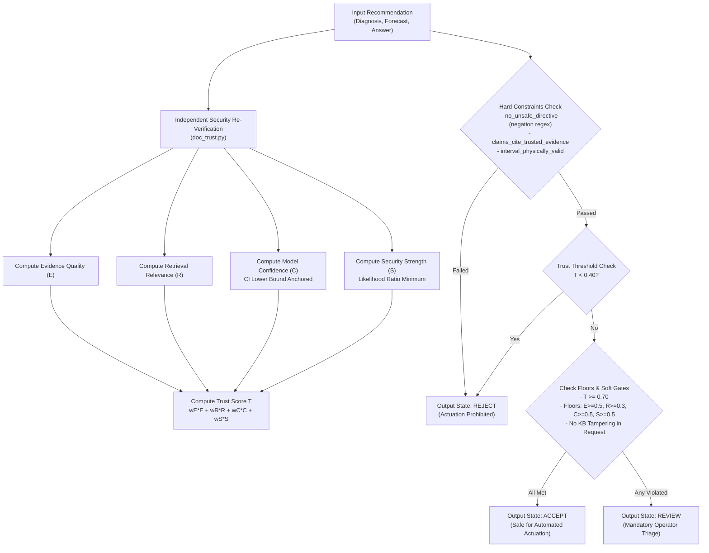
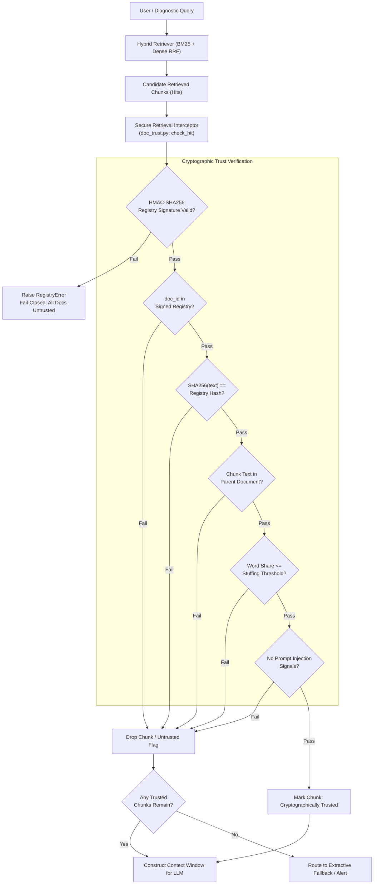

# 10. Formal Invention Disclosures

**Auditor:** Senior Software Architect, Patent Research Analyst & Registered Patent Drafter  
**Document Target:** Structured Invention Disclosures for Primary Patent Candidates  
**Date:** November 3, 2026  

---

## Invention Disclosure 1 (Candidate A)

### 1. Proposed Invention Title
**SYSTEM AND METHOD FOR MULTI-DIMENSIONAL TRUST-AWARE ARBITRATION AND AUTONOMOUS SAFETY GATING IN CYBER-PHYSICAL ARTIFICIAL INTELLIGENCE SYSTEMS**

### 2. Technical Field
Cyber-physical systems, industrial artificial intelligence, natural language generation safety, supervisory control and data acquisition (SCADA), and automated electric power grid management.

### 3. Background & Prior Art Limitations
Generative artificial intelligence (AI) and Large Language Models (LLMs) are increasingly integrated into industrial decision-support systems. In mission-critical environments such as electrical utility grids, generative models frequently exhibit hallucinations, generating plausible yet factually incorrect or physically dangerous recommendations. Conventional safety frameworks (such as Guardrails AI or NeMo Guardrails) rely on semantic blocklists or prompt filtering; they possess no mechanism to evaluate empirical confidence lower bounds, cryptographic evidence provenance, or physical operational envelopes. Consequently, deploying LLMs with direct or indirect actuation capability creates severe risks of physical equipment damage, electrical grid instability, and operator injury.

### 4. Summary of the Invention
The present invention provides an autonomous arbitration system that intercepts AI-generated recommendations and dynamically calculates a composite trust metric:
$$T = w_E E + w_R R + w_C C + w_S S$$
synthesizing:
1. An evidence quality score ($E$) derived from citation validity, delivery route factor, and evidence support level, collapsing to zero if any utilized evidence is untrusted.
2. A retrieval relevance score ($R$) computed via a logistic sigmoid transformation of cross-encoder ranking logits.
3. An empirical model confidence score ($C$) anchored to the statistical lower bound of a 95% confidence interval of the underlying detector, penalized to zero when the lower bound touches random chance ($\text{AUC} \le 0.50$).
4. An active security strength score ($S$) determined by the negative likelihood ratio of empirical detector error rates ($1 - \frac{1 - \text{TPR}}{1 - \text{FPR}}$).
5. A deterministic multi-tier gating processor that evaluates hard regular-expression safety boundaries with negative lookbehind, component attribution consistency, and threshold floors to output a discrete execution state selected from `ACCEPT`, `REVIEW`, and `REJECT`.

### 5. Detailed Technical Description & Architecture
Refer to source implementation in [`src/backend/trust/decision.py`](file:///c:/Users/priti/Desktop/greenrag_cloud_project/GreenRAG-Sec/src/backend/trust/decision.py#L9-L47).

### 6. Mathematical Formulations
- **Trust Metric:** $T = w_E E + w_R R + w_C C + w_S S$, where $\sum w = 1.0$.
- **Model Confidence Penalty:** $C_{\text{diag}} = \min(1.0, \max(0.0, \frac{\text{AUC}_{\text{low}} - 0.5}{0.5}))$.
- **Security Strength:** $S = \min_{k} [1 - \frac{1 - \text{TPR}_k}{1 - \text{FPR}_k}]$.
- **Negative-Lookbehind Safety Grammar:** Pattern matches directives (`bridge safety`, `disable protection`, `ignore alarm`) unless preceded within 25 characters by a negation token (`never`, `must not`, `do not`).

### 7. Exemplary Claim Directions

#### Independent System Claim (Control System Framing):
> **1. A trust-aware arbitration system for an electric power generation facility, comprising:**  
> a sensor interface configured to receive SCADA telemetry from one or more power generation assets;  
> an inference engine configured to generate an operational recommendation based on the SCADA telemetry and a retrieved knowledge base;  
> an arbitration processor communicatively coupled to the sensor interface and the inference engine, configured to:  
> (a) compute an evidence quality metric ($E$) by verifying that citations in the recommendation match cryptographically verified evidence chunks;  
> (b) compute an empirical model confidence metric ($C$) derived from a lower bound of a statistical confidence interval of an underlying anomaly detector, wherein the confidence metric is set to zero when the lower bound is less than or equal to random chance;  
> (c) compute an active security strength metric ($S$) based on an empirical likelihood ratio of an active anomaly screener;  
> (d) calculate a composite trust score ($T$) as a weighted combination of at least $E$, $C$, and $S$;  
> (e) evaluate the recommendation against an operational safety constraint using a negative-lookbehind grammatical parser; and  
> (f) generate a physical electrical control signal to actuate an equipment switch of the power generation facility when the trust score exceeds an acceptance threshold and the safety constraint is satisfied, and inhibit actuation and transmit an alert to an operator interface when the trust score is below the threshold or the confidence metric violates an acceptance floor.

#### Independent Method Claim:
> **2. A computer-implemented method for safely gating artificial intelligence recommendations in a supervisory control system, comprising:**  
> receiving a candidate recommendation from a generative language model;  
> calculating an evidence quality value by checking cited chunk identifiers against a signed registry;  
> calculating an empirical confidence value anchored to a lower limit of a detector ROC-AUC confidence interval;  
> calculating an active security confidence value based on a negative likelihood ratio;  
> computing a scalar trust score from the evidence, confidence, and security values;  
> parsing the recommendation to verify absence of non-negated unsafe directives; and  
> mapping the candidate recommendation to an `ACCEPT` state permitting automated command transmission only when the trust score satisfies an acceptance threshold and individual component floors are met, and mapping to a `REVIEW` state requiring operator confirmation otherwise.

---

## Invention Disclosure 2 (Candidate B)

### 1. Proposed Invention Title
**SYSTEM AND METHOD FOR SECURE RETRIEVAL-AUGMENTED GENERATION UTILIZING AN OFFLINE-SIGNED BUILD MANIFEST AND EVIDENCE INTEGRITY FILTERING**

### 2. Technical Field
Natural language processing, vector retrieval systems, adversarial cybersecurity, cryptographic provenance verification, and Retrieval-Augmented Generation (RAG).

### 3. Background & Prior Art Limitations
Standard RAG frameworks store text chunks and embeddings within vector databases (e.g., ChromaDB, Pinecone). Document hashes stored in vector databases are *self-declared* by the document ingestion pipeline. In real-world enterprise environments, vector databases are vulnerable to data poisoning, forged document uploads, and indirect prompt injection attacks embedded in technical manuals. When an attacker modifies or injects a document, they generate a matching self-declared hash, bypassing metadata checks and injecting malicious instructions into the generative model's prompt.

### 4. Summary of the Invention
The present invention provides a secure RAG architecture that establishes an **Offline Signed Build Registry** decoupling document retrieval from trust authorization. An offline build compiler recomputes SHA-256 hashes for all authentic documents and signs the canonical registry using an HMAC-SHA256 secret key stored in the secure execution environment (`GREENRAG_TRUST_KEY`). At query time, a retrieval interceptor intercepts vector search hits and verifies:
1. Membership in the signed registry (`registered`).
2. Exact matching against the offline registry hash (`registry_hash`).
3. Substring containment verifying that retrieved chunk text exists within the parent document (`chunk_in_doc`).
4. Statistical keyword-stuffing frequency distribution (`stuffing`).
5. Absence of prompt injection signals.
Any chunk failing verification is stripped prior to prompt construction, and contaminated queries are routed to an extractive quote fallback.

### 5. Detailed Technical Description & Architecture
Refer to source implementation in [`src/backend/security/doc_trust.py`](file:///c:/Users/priti/Desktop/greenrag_cloud_project/GreenRAG-Sec/src/backend/security/doc_trust.py#L45-L163) and [`src/backend/security/evidence_filter.py`](file:///c:/Users/priti/Desktop/greenrag_cloud_project/GreenRAG-Sec/src/backend/security/evidence_filter.py).

### 6. Exemplary Claim Directions

#### Independent System Claim:
> **1. A secure retrieval-augmented generation system, comprising:**  
> a memory storing an offline-compiled trust registry comprising a canonical mapping of authentic document identifiers to cryptographic document hashes, wherein the trust registry is digitally signed with an environmental secret key inaccessible to runtime ingestion interfaces;  
> a vector database storing embeddings and text chunks of a document corpus;  
> a processor configured to execute:  
> (a) a hybrid retrieval engine configured to retrieve candidate text chunks from the vector database in response to a query;  
> (b) a cryptographic verification interceptor configured to validate each candidate text chunk prior to prompt assembly by:  
> verifying the digital signature of the trust registry using the secret key;  
> confirming that a document identifier associated with the candidate text chunk exists in the verified trust registry;  
> hashing the associated document text and verifying equivalence with the hash recorded in the verified trust registry; and  
> verifying that the candidate text chunk exists as an exact substring within the associated document text;  
> (c) an evidence filter configured to discard candidate text chunks failing cryptographic verification; and  
> (d) a language model generator configured to generate a natural language response grounded exclusively on candidate text chunks verified by the cryptographic verification interceptor.

