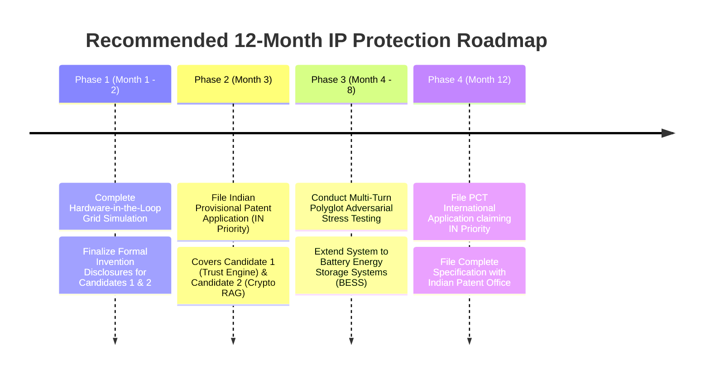

# 11. Patent Opportunity Ranking & IP Strategy Matrix

**Auditor:** Senior Software Architect, Patent Research Analyst & Algorithm Analyst  
**Document Target:** Prioritized Ranking of Inventions for Professional Patent Filings  
**Date:** November 3, 2026  

---

## 1. Executive Ranking Overview

The discovered inventive candidates within `GreenRAG-Sec` have been evaluated against five core criteria:
1. **Originality & Inventive Step:** Non-obviousness over existing public prior art.
2. **Implementation Grounding:** Completeness of actual source code and lack of theoretical hand-waving.
3. **Empirical Evidence:** Volume and rigor of measured benchmark verification in the repository.
4. **Tangible Technical Effect:** Ability to overcome statutory patent eligibility exclusions (Indian Patents Act Section 3(k) / US 35 U.S.C. § 101).
5. **Commercial & Strategic Value:** Defensibility and market impact for renewable energy operators and industrial AI providers.

```
┌────────────────────────────────────────────────────────────────────────┐
│                      PATENT OPPORTUNITY SUMMARY                        │
├────────────────────────────────────────────────────────────────────────┤
│ [1] HIGH PRIORITY:                                                     │
│     Candidate 1: Trust-Aware Decision Engine for SCADA Safety Gating   │
│                                                                        │
│ [2] MEDIUM-HIGH PRIORITY:                                              │
│     Candidate 2: Offline HMAC-SHA256 Build Registry RAG Architecture   │
│                                                                        │
│ [3] MEDIUM PRIORITY:                                                   │
│     Candidate 3: Multi-Stage SCADA Telemetry & Daily Replay Detector   │
│                                                                        │
│ [4] LOW PRIORITY:                                                      │
│     Candidate 4: Mondrian Group-Calibrated Conformal Quantile Regressor│
│                                                                        │
│ [5] NOT RECOMMENDED:                                                   │
│     Candidate 5: Hybrid Sparse/Dense RRF Retrieval with Cross-Encoder  │
└────────────────────────────────────────────────────────────────────────┘
```

---

## 2. Comprehensive Patent Opportunity Ranking Table

| Candidate Ref | Candidate Invention Description | Original Contribution Level | Implementation Evidence in Code | Prior-Art Risk Level | Technical Effect / Physical Utility | Preliminary Priority Rating |
|---|---|---|---|---|---|---|
| **CANDIDATE 1** | **Trust-Aware Multi-Signal Decision Engine with Statistical Confidence Anchoring & Safety Directives** | **High:** Independently formulated multi-signal framework coupling statistical confidence intervals ($C=0$ at chance) with negative likelihood ratios ($S$) and negative-lookbehind safety regex. | **Complete:** Fully implemented in `src/backend/trust/decision.py` (397 lines) and `signals.py`. | **Medium:** AI guardrails exist, but statistical confidence anchoring for cyber-physical gating is unique. | **Very High:** Directly controls electrical grid equipment actuation; prevents catastrophic physical damage. | **HIGH PRIORITY** |
| **CANDIDATE 2** | **Offline-Signed HMAC-SHA256 Build Registry & Substring Evidence Verification for RAG** | **High:** Decouples trust authority from vector DB; interceptor validates chunk containment, stuffing share, and provenance. | **Complete:** Fully implemented in `src/backend/security/doc_trust.py` (163 lines) and `evidence_filter.py`. | **Low-to-Medium:** Digital signatures are standard in OS security, but novel as an interceptor in RAG chunk pipelines. | **High:** Protects data integrity and prevents indirect prompt injection / poisoning attacks. | **MEDIUM-HIGH PRIORITY** |
| **CANDIDATE 3** | **Causal Multi-Sensor Cross-Consistency & Daily Normalized Profile Replay Detector** | **Moderate:** Combines physical efficiency/thermal residuals, Mahalanobis distance, and whole-day pairwise profile Euclidean distance. | **Complete:** Fully implemented in `src/backend/security/scada_anomaly.py` (193 lines). | **Medium-to-High:** Industrial anomaly detection is crowded; novelty lies in specific 5-check combination and daily replay metric. | **Moderate-to-High:** Ensures power generation models receive uncorrupted SCADA streams. | **MEDIUM PRIORITY** |
| **CANDIDATE 4** | **Mondrian Group-Calibrated Conformal Quantile Regression for Diurnal Power Regimes** | **Low-to-Moderate:** Domain application of CQR (Romano et al., 2019) partitioned by day/night solar regimes and wind curve brackets. | **Complete:** Fully implemented in `src/backend/forecasting/uncertainty.py` (282 lines). | **High:** Theoretical CQR and Mondrian grouping are published literature. | **Moderate:** Provides finite-sample prediction interval guarantees for utility reserve margins. | **LOW PRIORITY** |
| **CANDIDATE 5** | **Hybrid BM25 + Dense RRF with Cross-Encoder Reranking and Sibling Expansion** | **Minimal:** Standard combination of Elasticsearch/BM25 and ChromaDB via reciprocal rank fusion and ms-marco cross-encoder. | **Complete:** Implemented in `src/backend/retrieval/hybrid_retriever.py` (182 lines). | **Very High:** Established industry best practice; anticipated by numerous open-source libraries. | **Low (Software-only):** General text retrieval ranking improvement. | **NOT RECOMMENDED** |

---

## 3. Detailed Justification for Each Ranking

### Candidate 1: Trust-Aware Decision Engine (HIGH PRIORITY)
- **Why High Priority:**
  This candidate represents the intellectual core of the repository's safety proposition. Unlike conventional AI software that simply displays an answer, this system functions as an **autonomous arbiter** designed to sit between an uncalibrated LLM and physical equipment switches.
- **Defensibility under Indian Law (Section 3(k)):**
  Because the engine outputs deterministic control states (`ACCEPT` vs. `REVIEW` vs. `REJECT`) that regulate physical grid assets (turbines, inverters, circuit breakers), claims drafted to a **cyber-physical energy management control system** easily satisfy the technical effect requirements established in *Ferid Allani v. Union of India* and the IPO 2017 CRI Guidelines.
- **Empirical Backing:**
  Validated on 374 capture cases and a 969-point sensitivity sweep in `results/trust/c5_summary.md`.

---

### Candidate 2: Cryptographic Offline Build Registry for RAG (MEDIUM-HIGH PRIORITY)
- **Why Medium-High Priority:**
  Retrieval-Augmented Generation is the dominant enterprise AI pattern, yet knowledge base poisoning remains an unsolved vulnerability. The architectural decoupling of the vector database (untrusted storage) from an offline HMAC-signed build manifest (trust authority) provides a clean, elegant, and computationally lightweight ($7.7\text{ ms}$) solution.
- **Patentability Strength:**
  Cybersecurity and data integrity mechanisms generally enjoy smooth prosecution under both USPTO (Alice Step 2A/2B) and Indian patent law because they solve a technical data-tampering problem using cryptographic technical means.
- **Empirical Backing:**
  Demonstrated 100% detection rate on 17/17 poisoned documents while self-declared hashing achieved 0% (`results/security/c3_summary.md`).

---

### Candidate 3: SCADA Telemetry & Daily Replay Detector (MEDIUM PRIORITY)
- **Why Medium Priority:**
  While the daily profile distance replay check ($\epsilon_{\text{replay}}$) is clever and achieved 100% detection across 31 wind and 10 solar replay days, power systems literature has extensive prior art in state estimation and bad data detection. It is best filed either as a secondary utility patent or incorporated as dependent claims under the Candidate 1 system.

---

### Candidate 4: Mondrian Group-Calibrated CQR Forecaster (LOW PRIORITY)
- **Why Low Priority:**
  Conformal Quantile Regression is well-attributed to Romano, Sesia, and Candès (2019). While grouping by daylight and nocturnal hours makes intuitive engineering sense for solar energy, a patent examiner will likely view partitioning data by time-of-day as an obvious design choice rather than an inventive step.

---

### Candidate 5: Hybrid RRF + Cross-Encoder Reranker (NOT RECOMMENDED)
- **Why Not Recommended:**
  Combining BM25, dense embeddings, Reciprocal Rank Fusion, and cross-encoders is standard industry practice widely described in blogs, tutorials, and open-source packages (e.g., LangChain, Cohere, Pinecone). Attempting to patent this would waste resources and face immediate Section 2(1)(ja) obviousness rejections.

---

## 4. Strategic IP Filing Roadmap



