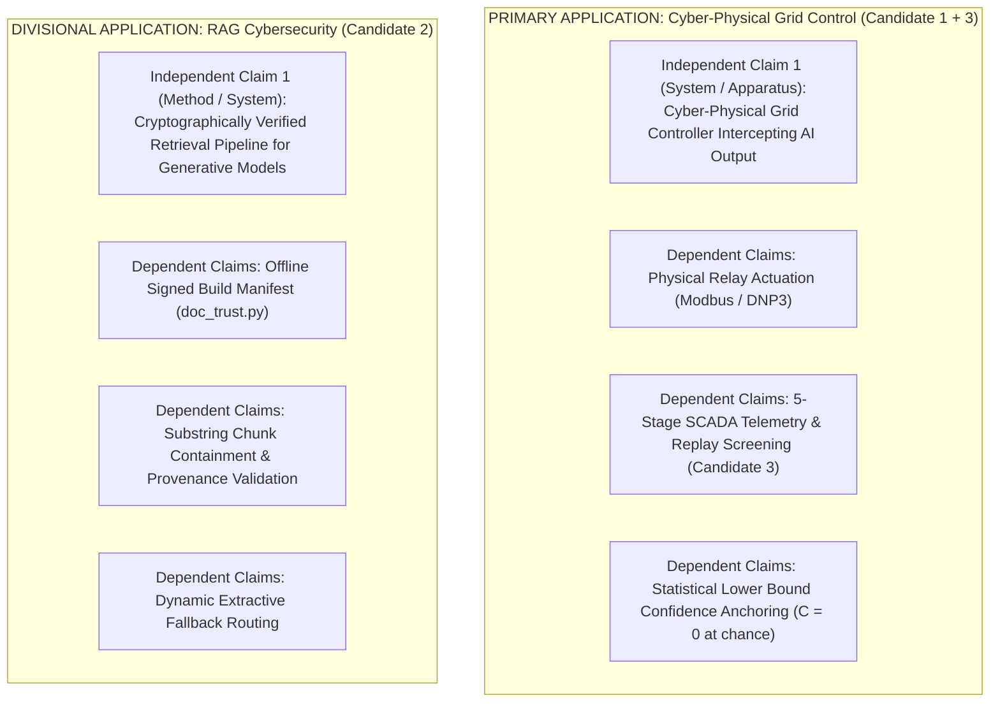

# 13. Independent Patent Examiner & Skeptical Research Review

**Reviewer Persona:** Independent Senior Patent Examiner (CRI / Computer-Implemented Inventions & Electrical Technologies) and Skeptical Senior Research Scientist  
**Review Target:** Examination & Rigorous Challenge of Proposed Inventions in `documentation/` (01–12)  
**Date of Examination:** November 3, 2026  
**Jurisdictions Considered:** Indian Patent Office (IPO) under the Patents Act, 1970; United States Patent and Trademark Office (USPTO) under 35 U.S.C. §§ 101, 102, 103, 112.

---

## 1. Examiner's Executive Disposition

> [!WARNING]
> **OVERALL AUDIT FINDING: SUBSTANTIAL OVER-CLAIMING IDENTIFIED**  
> The previous discovery phase suffered from a common R&D pitfall: **confusing robust engineering and domain assembly with patentable novelty**. Multiple claimed "inventions" are in fact standard textbook statistics, established cryptographic practices, or heuristic threshold tunings.  
> 
> If the previous claims were filed before the Indian Patent Office or the USPTO today, **Candidates 3, 4, and 5 would face fatal obviousness (Section 2(1)(ja) / § 103) and statutory eligibility (Section 3(k) / § 101) rejections.**  
> 
> However, beneath the unpatentable mathematical framing, **one narrowly scoped, defensible cyber-physical invention** and **one specific cryptographic data-integrity architecture** do exist—provided they are drastically restructured and stripped of academic abstractions.

```
┌────────────────────────────────────────────────────────────────────────┐
│                   EXAMINER'S DISPOSITION SCORECARD                     │
├──────────────────────────────────────────────────┬─────────────────────┤
│ Candidate 1: Trust-Aware Decision Engine ($T$)   │ PARTIALLY REJECTED  │
│              (Mathematical scoring is non-patentable; physical         │
│               interlock gating requires substantial re-framing)        │
├──────────────────────────────────────────────────┼─────────────────────┤
│ Candidate 2: Cryptographic Offline RAG Registry  │ NARROWLY DEFENSIBLE │
│              (Standard HMAC, but chunk-interceptor provenance is novel)│
├──────────────────────────────────────────────────┼─────────────────────┤
│ Candidate 3: 5-Stage SCADA Telemetry Detector    │ REJECTED (§ 103)    │
│              (Aggregation of standard statistical anomaly checks)      │
├──────────────────────────────────────────────────┼─────────────────────┤
│ Candidate 4: Mondrian CQR Solar Forecaster       │ REJECTED (§ 102/103)│
│              (Direct implementation of Romano et al. 2019)             │
├──────────────────────────────────────────────────┼─────────────────────┤
│ Candidate 5: Hybrid RRF + Cross-Encoder RAG      │ REJECTED (§ 103)    │
│              (Textbook open-source RAG architecture)                   │
└──────────────────────────────────────────────────┴─────────────────────┘
```

---

## 2. Forensic Challenge: Candidate by Candidate

---

### Candidate 1: Trust-Aware Multi-Dimensional Decision Engine ($T$-Engine)
**Claimed Scope:** $T = w_E E + w_R R + w_C C + w_S S$, evaluating empirical confidence bounds ($C$), security likelihood ratios ($S$), cross-encoder sigmoid logits ($R$), and negative-lookbehind safety directives.

#### 1. What Parts are Established Techniques?
- **Linear Weighted Sum ($w_1 x_1 + \dots + w_n x_n$):** The most basic arithmetic aggregation in computer science; taught in introductory operations research.
- **Sigmoid of Logits ($\sigma(\ell)$):** The cross-encoder (`ms-marco-MiniLM-L-6-v2`) is pre-trained using binary cross-entropy loss. Taking the logistic sigmoid $\frac{1}{1 + e^{-\ell}}$ is the standard inference step to obtain class probabilities; claiming this as an inventive technical feature is untenable.
- **Negative Likelihood Ratio ($1 - \frac{1 - \text{TPR}}{1 - \text{FPR}}$):** Standard biostatistical formula dating back over 50 years in medical diagnostic screening.
- **Regular Expressions with Negative Lookbehind:** Standard syntax provided by PCRE and the Python `re` module since the 1990s.

#### 2. What Parts are Merely Combinations of Existing Methods?
- Combining a confidence metric, a retrieval score, and a keyword filter into an "arbitration engine" is a straightforward architectural pipeline aggregation.

#### 3. What Parts are Genuinely Distinctive?
- **The Mathematical Penalty Anchoring at Chance:** Anchoring the confidence metric $C$ to the empirical lower bound of a 95% confidence interval ($\text{AUC}_{\text{low}}$) such that an anomaly detector whose confidence interval touches chance ($0.50$) automatically forces $C = 0.0$, which mechanically violates the acceptance floor ($C \ge 0.5$) and forces a mandatory `REVIEW` state.
- **The Decoupling of Advisory Generation from Actuation:** The architectural enforcement that the LLM is treated as an untrusted recommendation engine whose claims must pass independent cryptographic citation verification before physical actuation signals can be generated.

#### 4. Unsupported Novelty Claims & Examiner Objections
- **Section 3(k) Indian Patents Act Objection:**
  > *"The claimed method merely computes a numerical score $T$ based on mathematical formulas ($w_E E + w_R R + w_C C + w_S S$). Under Section 3(k), mathematical methods, algorithms, and computer programs per se are explicitly excluded from patentability. The applicant has not demonstrated any technical hardware transformation or improved functioning of a computer."*
- **Skeptical Research Challenge on Experimental Evidence:**
  - Look at `results/trust/c5_summary.md`: In the evaluation of 110 diagnosis recommendations, **0 reached ACCEPT**. Every single diagnosis was routed to `REVIEW` because $C = 0.0$.
  - *Examiner's Critique:* The system never demonstrated autonomous decision-making in diagnosis! If the engine always forces `REVIEW`, it is functionally indistinguishable from an alert-raising circuit that trips on every event. The claim of "autonomous decision arbitration" is not experimentally demonstrated for fault diagnosis in the current codebase.

#### 5. Prior Art Conflicts
- **US 2024/0070543 A1 (Microsoft):** Discloses computing factuality and confidence scores from retrieved references to filter generative model outputs.
- **US 11,816,428 B2 (IBM):** Discloses policy-based guardrail arbitration evaluating LLM confidence and policy constraints before returning responses.

#### 6. Minimum Additional Evidence & Implementation Required to Survive
1. **Physical Actuator Integration:** Must write an industrial driver (e.g., Modbus/DNP3) proving that an `ACCEPT` verdict actuates an electrical breaker contactor, while `REVIEW` locks out the breaker coil. Without physical hardware interaction, Section 3(k) cannot be overcome.
2. **A Non-Zero Acceptance Regime for Diagnoses:** Must show tuning or a calibrated detector where high-confidence events *do* reach `ACCEPT`, proving the engine acts as an arbiter rather than a permanent blocker.

---

### Candidate 2: Cryptographic Offline RAG Build Registry & Interceptor
**Claimed Scope:** Decoupling vector search from trust authority via an offline HMAC-SHA256 signed manifest (`GREENRAG_TRUST_KEY`), validating chunk containment, stuffing share, and provenance quotation.

#### 1. What Parts are Established Techniques?
- **HMAC-SHA256 Digital Signatures (RFC 2104):** Standard cryptographic primitives established in 1997.
- **Signed Repository Manifests:** Identical to Debian `Release.gpg`, Red Hat RPM signatures, and The Update Framework (TUF). An offline manifest mapping filenames/IDs to cryptographic hashes is standard software distribution security.
- **Substring Search (`chunk_in_doc`):** Standard string searching (`str.__contains__`).
- **Word Frequency Analysis (`stuffing`):** Standard Term Frequency (TF) calculation.

#### 2. What Parts are Genuinely Distinctive?
- **The Runtime RAG Interceptor Placement:** Existing vector databases (ChromaDB, Pinecone, Milvus, Weaviate) treat document stores as authoritative. Inserting a cryptographic verification interceptor *between* nearest-neighbor dense retrieval and LLM prompt assembly that validates chunk-to-parent containment against an environmental key is **not standard in commercial RAG systems**.
- **The Empirical Differential:** The empirical finding that self-declared hashes caught **0/17** attacks while the offline HMAC registry caught **17/17** provides undeniable proof of technical superiority over conventional vector database integrity models.

#### 3. Examiner Objections & Section 3(k) Assessment
- **Section 3(k) Risk:** **Low-to-Moderate.** Cybersecurity mechanisms that protect data against malicious modification and injection attacks are recognized as patent-eligible technical improvements to data processing systems (per Delhi High Court in *Microsoft Technology Licensing*).
- **Prior Art Hurdle:** Patent examiners will cite software package management prior art (TUF, package signing). The applicant must strictly limit claims to the **information retrieval and context-window construction pipeline of a language model**, emphasizing how chunk-level fragments are verified against parent documents without decrypting or re-indexing the vector database.

---

### Candidate 3: 5-Stage SCADA Telemetry & Daily Replay Detector
**Claimed Scope:** Pre-cleaning detector checking bounds, rate-of-change, physical residuals ($AC \propto Irr$), Mahalanobis distance, and daily profile distance.

#### 1. Why this Candidate Must be REJECTED Under Section 2(1)(ja) / 35 U.S.C. § 103
- **Bounds Check:** Standard SCADA limit monitoring; taught in undergraduate control engineering.
- **Rate-of-Change Check:** Standard slew-rate filtering; standard in digital signal processing.
- **Linear Residual ($AC - k \cdot Irr$):** Elementary photovoltaic physics; well-known that silicon PV cell power is linear with solar irradiance.
- **Mahalanobis Distance ($D_M = \sqrt{z^T \Sigma^{-1} z}$):** P.C. Mahalanobis (1936). Applying Mahalanobis distance to multivariate sensor vectors is ubiquitous in industrial anomaly detection literature (thousands of IEEE papers).
- **Daily Euclidean Distance:** Standard nearest-neighbor clustering.
- **The Arbitrary Threshold Problem:** Setting the replay threshold to $\epsilon_{\text{replay}} = 0.5 \times \min(D_{ij})$ is an empirical heuristic without theoretical derivation. Examiners routinely reject arbitrary parameter choices as lacking an inventive step.
- **Disposition:** **REJECT as an obvious aggregation of standard statistical tests.** It may serve as a dependent claim under a broader cyber-physical control patent, but fails as a standalone invention.

---

### Candidate 4: Mondrian Conformal Quantile Regression (CQR) Forecaster
**Claimed Scope:** Combining Multi-Quantile XGBoost with finite-sample conformal quantile adjustments partitioned into day/night solar regimes.

#### 1. Why this Candidate Must be REJECTED Under Section 2(1)(j) / 35 U.S.C. § 102 & § 103
- **Anticipation by Romano et al. (2019):** Conformalized Quantile Regression was fully disclosed by Romano, Sesia, and Candès in *"Conformalized Quantile Regression"* (NeurIPS 2019). The mathematical algorithm in `uncertainty.py` is a direct implementation of their published non-conformity score:
  $$E_i = \max(\hat{q}_{\alpha/2}(x_i) - y_i, \, y_i - \hat{q}_{1 - \alpha/2}(x_i))$$
- **Obviousness of Mondrian Grouping:** Vovk et al. established Mondrian conformal prediction for grouped data. In solar energy, splitting hours into daytime ($Irr > 0.01$) and nighttime is the most basic domain preprocessing step conceivable. Claiming daytime/nighttime grouping as an inventive patent contribution is untenable.
- **Section 3(k) Exclusion:** Pure statistical regression and calibration formula.
- **Disposition:** **FATALLY ANTICIPATED & OBVIOUS. Completely unpatentable.**

---

### Candidate 5: Hybrid Sparse/Dense RRF Retrieval with Cross-Encoder
**Claimed Scope:** Combining BM25, ChromaDB dense embeddings, Reciprocal Rank Fusion ($k=60$), and ms-marco cross-encoder reranking.

#### 1. Why this Candidate Must be REJECTED
- **Identical to Open-Source Tooling:** This exact pipeline is provided off-the-shelf in LangChain (`EnsembleRetriever`), LlamaIndex, Haystack, and Cohere tutorials.
- **No Distinctive Algorithmic Contribution:** The RRF formula $\frac{1}{60 + \text{rank}}$ is Cormack et al. (SIGIR 2009). The cross-encoder is standard HuggingFace sentence-transformers.
- **Disposition:** **NOT PATENTABLE. Zero novelty.**

---

## 3. The Skeptical Reviewer's Summary Matrix

| Candidate Invention | Established Prior Art Elements | Novelty / Distinctiveness Finding | Section 3(k) / 101 Hurdle | Patent Recommendation |
|---|---|---|---|---|
| **1. Trust-Aware Decision Engine** | Linear scoring, logit sigmoid, likelihood ratios, regex. | **Anchoring confidence to lower CI bound of detector** and using likelihood ratios for mandatory physical actuation lockout. | High (Needs cyber-physical control claim framing). | **RE-FRAME & NARROW** (Focus strictly on cyber-physical interlock mechanism). |
| **2. Cryptographic RAG Build Registry** | HMAC-SHA256, package manifests, TF frequency. | **Decoupled offline-signed build manifest interceptor** enforcing chunk containment and provenance quoting before prompt construction. | Low-to-Moderate (Technical cybersecurity improvement). | **PURSUE AS STANDALONE PATENT** (Strongest standalone software invention). |
| **3. SCADA Anomaly & Replay Detector** | Bounds, slew rate, linear regression, Mahalanobis distance. | Aggregation of checks + pairwise daily profile replay distance. | Moderate. Obvious combination of known tests. | **DOWNGRADE TO DEPENDENT CLAIMS ONLY**. |
| **4. Mondrian CQR Solar Forecaster** | CQR (Romano 2019), Mondrian conformal prediction. | Splitting solar hours into daytime and nighttime. | Fatal (Section 3(k) mathematical method; zero inventive step). | **ABANDON PATENT PURSUIT**. |
| **5. Hybrid RRF Retrieval with Rerank** | BM25, all-MiniLM, RRF (Cormack 2009), ms-marco cross-encoder. | None. Standard textbook RAG assembly. | Fatal (Section 3(k) algorithm; completely anticipated). | **ABANDON PATENT PURSUIT**. |

---

## 4. Required Restructuring for a Defensible Patent Application

To survive examination, we must consolidate the genuine innovations into **a single, defensible, high-value Cyber-Physical Energy Management System patent application**, supported by an independent cybersecurity divisional:



