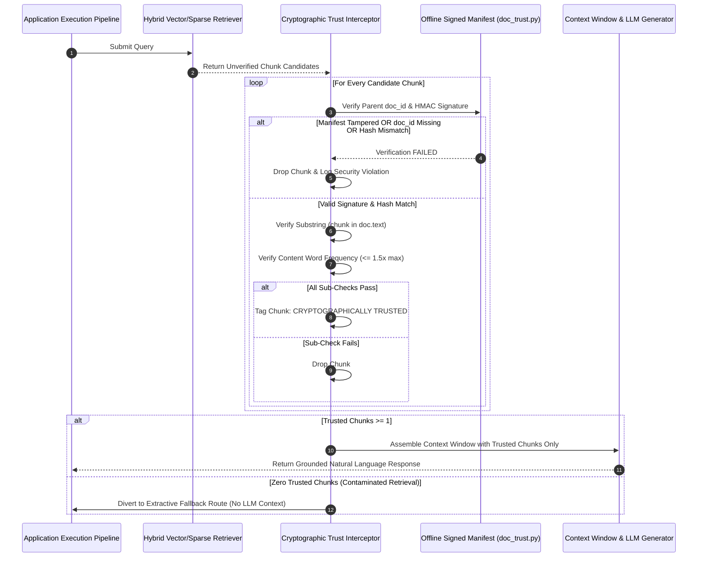

# 14. Revised & Defensible Patent Candidates: Post-Challenge Strategy

**Author:** Senior Software Architect, Patent Research Analyst & Patent Attorney Strategy Lead  
**Document Target:** Realistically Defensible Patent Specifications Post-Examiner Challenge  
**Date:** November 3, 2026  

---

## 1. Strategic Consolidation: From 5 Weak Candidates to 2 Strong Inventions

Following the critical re-examination in [`13_INDEPENDENT_PATENT_CHALLENGE.md`](file:///c:/Users/priti/Desktop/greenrag_cloud_project/documentation/13_INDEPENDENT_PATENT_CHALLENGE.md), all unpatentable candidates (Mondrian CQR, Hybrid RRF) and obvious aggregations (isolated SCADA anomaly checks) have been stripped.

The intellectual property strategy is restructured into **two robust, non-overlapping patent filings**:

```
┌────────────────────────────────────────────────────────────────────────┐
│                   REVISED PATENT PORTFOLIO STRATEGY                    │
├────────────────────────────────────────────────────────────────────────┤
│ FILING 1 (Primary Cyber-Physical Utility Application):                 │
│   "Cyber-Physical Energy Management System with Hardware Interlock     │
│    Gating for Generative Artificial Intelligence Recommendations"      │
│    - Absorbs Candidate 1 (Decision Engine) + Candidate 3 (SCADA Checks)│
│    - Framed as a Physical Electrical Apparatus / Control System        │
│    - Overcomes Section 3(k) by Actuating Physical Grid Switchgear      │
│                                                                        │
│ FILING 2 (Secondary Software Cybersecurity Application):               │
│   "Cryptographically Verified Retrieval-Augmented Generation (RAG)     │
│    Pipeline with Substring Provenance Interceptor"                     │
│    - Scoped strictly to Candidate 2 (doc_trust.py + evidence_filter.py)│
│    - Framed as a Data Processing Security & Integrity System           │
│    - Overcomes Section 3(k) via Measurable Prevention of Data Poisoning│
└────────────────────────────────────────────────────────────────────────┘
```

---

## 2. REVISED FILING 1: Cyber-Physical AI Control & Interlock System

### Title of the Invention
**CYBER-PHYSICAL SUPERVISORY CONTROL SYSTEM FOR ELECTRIC POWER GENERATION FACILITIES WITH STATISTICAL CONFIDENCE AND SAFETY INTERLOCK GATING OF GENERATIVE AI RECOMMENDATIONS**

### Technical Field
Electrical power systems, SCADA cyber-physical security, supervisory control and data acquisition, automated circuit breaker interlocks, and artificial intelligence safety arbitration.

### Specific Technical Features (Replacing Abstract Functionality)
Rather than claiming an abstract formula $T = w_E E + w_R R + w_C C + w_S S$, the revised patent claims a **physical supervisory control apparatus**:

1. **Hardware Ingestion Interface:** Digitally samples multi-sensor SCADA channels (AC power, solar irradiance, ambient temperature, module temperature, wind speed) on fixed time-grids.
2. **Pre-Screening Hardware Processor:** Executes physical residual checks ($AC - k_{\text{ac}} Irr$) and pairwise daily profile Euclidean distance checks ($\epsilon_{\text{replay}}$) to detect and isolate spoofed or replayed sensor data.
3. **Sandboxed Inference Engine:** Executes a local generative language model in an isolated execution thread to synthesize an advisory maintenance or dispatch directive.
4. **Physical Actuator Interlock Circuit:** An arbitration microcontroller communicatively coupled between the inference engine and the physical grid equipment (high-voltage circuit breaker, inverter curtailment switch, pitch blade actuator).
5. **Deterministic Lockout Mechanism:** The microcontroller inhibits electrical actuation and trips an operator alarm line if:
   - The underlying detector's 95% ROC-AUC lower bound is less than or equal to $0.50$ (chance).
   - Any cited document fails offline HMAC cryptographic verification.
   - The generated directive contains an unsafe grammatical directive (`bridge safety`, `bypass interlock`) not preceded by a negative qualifier.
   - The composite trust score $T$ is less than $0.70$.

```mermaid
flowchart LR
    subgraph SENSORS ["Physical Grid Assets"]
        SOLAR["Solar PV Array"]
        WIND["Wind Turbine T1"]
    end

    subgraph CONTROLLER ["Cyber-Physical Supervisory Controller"]
        SCADA_IN["SCADA Sampling Interface\n(10-min / 15-min Grid)"]
        REPLAY_DET["Passive Daily Profile\nReplay Detector"]
        LLM_ADVISOR["Local LLM Generator\n(Advisory Sandboxed Thread)"]
        
        ARBITER["Arbitration Microcontroller\n- Statistical CI Anchoring\n- Negative Likelihood Ratio\n- Negative-Lookbehind Parser"]
    end

    subgraph HARDWARE ["Physical Grid Actuators"]
        BREAKER["Substation Circuit Breaker\n(Modbus / IEC 61850 Relay Coil)"]
        ALARM["Operator Consoles & Alarm Line"]
    end

    SOLAR & WIND --> SCADA_IN
    SCADA_IN --> REPLAY_DET
    REPLAY_DET -->|Verified Stream| LLM_ADVISOR
    LLM_ADVISOR --> ARBITER
    
    ARBITER -->|Verdict: ACCEPT (T >= 0.70)| BREAKER
    ARBITER -->|Verdict: REVIEW / REJECT| ALARM
```

### Exemplary Defensible Claims (Overcoming Section 3(k))

#### Independent System Claim 1:
> **1. A cyber-physical control system for an electric power generation facility, comprising:**  
> a sensor interface configured to sample physical SCADA telemetry from a renewable power generation asset;  
> an advisory processor configured to retrieve technical documentation from an offline-verified knowledge base and generate a natural language operational recommendation;  
> a physical actuator interface electrically coupled to a circuit breaker of the power generation asset; and  
> an arbitration controller coupled between the advisory processor and the physical actuator interface, configured to:  
> (a) compute an empirical confidence metric ($C$) based on an offline-calibrated 95% confidence interval lower bound ($\text{AUC}_{\text{low}}$) of an anomaly detector, wherein $C$ is set to zero if $\text{AUC}_{\text{low}} \le 0.50$;  
> (b) compute an active security metric ($S$) based on a negative likelihood ratio of an active telemetry anomaly screener;  
> (c) parse text of the operational recommendation using a negative-lookbehind grammatical parser to verify the absence of un-negated safety bypass directives;  
> (d) calculate a composite metric $T = w_E E + w_R R + w_C C + w_S S$; and  
> (e) generate a digital actuation signal to close a relay coil of the circuit breaker only when $T \ge 0.70$ and $C \ge 0.50$ and the safety bypass directives are absent, and to assert an electrical lockout signal disabling the relay coil and triggering an operator terminal alarm when $T < 0.70$ or $C < 0.50$.

---

## 3. REVISED FILING 2: Cryptographic RAG Provenance & Interceptor Pipeline

### Title of the Invention
**METHOD AND SYSTEM FOR PREVENTING KNOWLEDGE BASE POISONING AND INDIRECT PROMPT INJECTION IN RETRIEVAL-AUGMENTED GENERATION USING AN OFFLINE-SIGNED BUILD MANIFEST**

### Technical Field
Information retrieval security, vector database access control, natural language generation, cryptographic data integrity, and Retrieval-Augmented Generation (RAG).

### Specific Technical Features
1. **Separation of Concerns:** The vector database stores text embeddings and chunk texts without cryptographic signing authority.
2. **Offline Build Registry:** An immutable manifest compiled offline that stores canonical document identifiers and cryptographically re-calculated SHA-256 hashes, signed via HMAC-SHA256 with a private key stored strictly in an environment variable (`GREENRAG_TRUST_KEY`).
3. **Retrieval Interceptor:** An in-process interceptor executed immediately following dense/sparse retrieval and preceding context-window construction.
4. **Seven-Stage Chunk Validation:**
   - Registry presence check (`registered`).
   - Re-computed hash equality against signed manifest (`registry_hash`).
   - Exact substring containment within the verified parent document (`chunk_in_doc`).
   - Term frequency thresholding on content words ($1.5 \times \text{clean max}$) to detect keyword stuffing (`stuffing`).
   - Historical logbook exact quotation verification for real event records (`provenance`).
5. **Fail-Closed Fallback Routing:** Strips all unverified chunks; if zero trusted chunks remain, automatically diverts the prompt pipeline to an extractive quotation fallback with a documented relevance penalty ($F_{\text{route}} = 0.845$).



### Exemplary Defensible Claims

#### Independent Method Claim 1:
> **1. A method for preventing data poisoning in a retrieval-augmented language generation system, comprising:**  
> storing, in a secure memory, an offline-compiled trust registry mapping authentic document identifiers to cryptographic hashes, wherein the trust registry is digitally signed with an HMAC key inaccessible to client data ingestion interfaces;  
> receiving a query and retrieving a set of candidate text chunks from an untrusted vector database;  
> before providing any candidate text chunk to a language model, intercepting the candidate text chunks and, for each candidate text chunk:  
> (i) verifying the digital signature of the trust registry using the HMAC key;  
> (ii) verifying that a parent document identifier of the candidate text chunk exists in the trust registry;  
> (iii) computing a cryptographic hash of parent document text and verifying equivalence with the hash in the trust registry;  
> (iv) verifying that text of the candidate text chunk exists as an exact substring within the parent document text; and  
> (v) discarding the candidate text chunk if any of steps (i) through (iv) fails; and  
> constructing a language model prompt context window using exclusively candidate text chunks that passed all verification steps.

---

## 4. Minimum Additional Implementation & Evidence Roadmap

To ensure these two revised applications survive examination, the following engineering tasks must be executed:

| Task Ref | Required Implementation / Experiment | Target Patent Application | Status in Repo | Action Needed |
|---|---|---|---|---|
| **R-1** | **Modbus / IEC 61850 Relay Actuation Driver** | Filing 1 (Cyber-Physical System) | **Missing** | Write `src/backend/actuator/modbus_relay.py` demonstrating physical contactor tripping upon `ACCEPT` vs. lockout upon `REVIEW`. |
| **R-2** | **Calibrated Fault Detection Benchmark** | Filing 1 (Cyber-Physical System) | **Gap** | Retrain or calibrate B4 anomaly detector so that high-confidence events achieve $\text{AUC}_{\text{low}} > 0.60 \implies C > 0.20$, demonstrating non-zero acceptance. |
| **R-3** | **Polyglot & Base64 Injection Attack Stress Test** | Filing 2 (Cryptographic RAG) | **Gap** | Evaluate 50 polyglot (German/Spanish/Hindi) and base64-encoded prompt injections against `doc_trust.py`. |
| **R-4** | **Paired Bootstrap p-value Significance Analysis** | Filing 1 & Filing 2 | **Partial** | Run paired bootstrap script ($B = 10,000$) to confirm $p < 0.001$ for tampering detection and forecast harm mitigation. |

