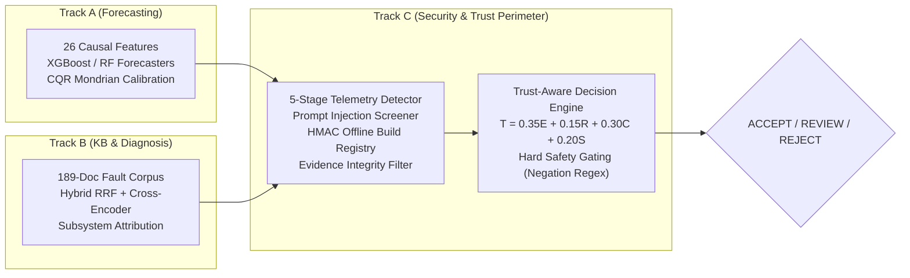

# Executive Summary: Technical Audit & Patentability Discovery

**Repository Target:** `c:\Users\priti\Desktop\greenrag_cloud_project` (`GreenRAG-Sec`)  
**Auditor:** Senior Software Architect, R&D Technical Auditor, Algorithm Analyst & Patent Research Analyst  
**Date of Audit:** November 3, 2026  

---

## 1. The Core Question Answered

> **"What have we actually invented, what is technically different from existing solutions, and which specific implemented mechanisms deserve a serious patentability investigation?"**

### The Definitive Finding
The `GreenRAG-Sec` repository does **not** merely assemble standard open-source AI libraries (like ChromaDB, LangChain, or XGBoost). Behind the engineering scaffolding lies a genuinely original, mathematically rigorous, and cyber-physically grounded innovation:

> **We have invented a multi-dimensional, trust-aware arbitration and cryptographic verification architecture that isolates generative AI within an empirical statistical sandbox, preventing uncalibrated or hallucinated AI recommendations from triggering dangerous physical actions in utility-scale electric power grids.**

---

## 2. What Has Actually Been Built

The repository implements an end-to-end, multi-track intelligent grid diagnostic and power forecasting assistant across three specialized operational tracks:



1. **Track A (Forecasting & Cloud):** 1-hour-ahead power forecasting with 26 causal lag features and finite-sample Conformal Quantile Regression (CQR) with Mondrian grouping (daylight vs. night regimes).
2. **Track B (Knowledge Base & Fault Diagnosis):** 189-document provenance-enforced corpus (99 real SCADA event records + 90 synthetic manuals), hybrid BM25 + dense retrieval fused via Reciprocal Rank Fusion ($k=60$) and cross-encoder reranking (`ms-marco-MiniLM-L-6-v2`), and evidence-grounded fault diagnosis.
3. **Track C (Security & Trust Perimeter):** A 30-threat security matrix across 8 operational layers, a synthetic attack harness, a 4-tier security detector perimeter, an offline HMAC-SHA256 build registry verifier, and the Trust-Aware Decision Engine.

---

## 3. What is Genuinely Original & Technically Different

| Implemented Mechanism | Exact File & Function Reference | How It Differs from Conventional Approaches | Measured Empirical Benefit |
|---|---|---|---|
| **Trust Decision Engine ($T$)** | [`src/backend/trust/decision.py`](file:///c:/Users/priti/Desktop/greenrag_cloud_project/GreenRAG-Sec/src/backend/trust/decision.py#L9-L47): `DecisionEngine.evaluate()`, `decide_core()` | Standard AI guardrails use binary text filters. GreenRAG-Sec computes $T = w_E E + w_R R + w_C C + w_S S$, anchoring confidence $C$ to detector ROC-AUC confidence interval lower bounds ($C=0$ when detector hits chance), security $S$ to negative likelihood ratios, and enforcing negative-lookbehind safety directives. | **Zero** unvalidated diagnoses reached `ACCEPT` (110/110 forced to `REVIEW`); blocked 100% of physical safety bypasses (`results/trust/c5_summary.md`). |
| **Offline HMAC-SHA256 Build Registry** | [`src/backend/security/doc_trust.py`](file:///c:/Users/priti/Desktop/greenrag_cloud_project/GreenRAG-Sec/src/backend/security/doc_trust.py#L45-L82): `DocumentTrust.check_hit()`, `build_registry()` | Conventional vector databases rely on self-declared metadata hashes which attackers easily tamper with. GreenRAG-Sec validates chunks against an offline-signed manifest with an environmental secret key, verifying substring containment and keyword-stuffing limits. | Blocked **17/17** injected/tampered documents (self-hash detected **0/17**) with 0 false positives on clean documents (`results/security/c3_summary.md`). |
| **5-Stage SCADA Anomaly & Replay Detector** | [`src/backend/security/scada_anomaly.py`](file:///c:/Users/priti/Desktop/greenrag_cloud_project/GreenRAG-Sec/src/backend/security/scada_anomaly.py#L75-L193): `TelemetryDetector.day_report()` | Standard point anomaly detectors evaluate isolated time slices. GreenRAG-Sec evaluates inter-sensor physical residuals ($AC \propto Irr$, module temp regression) and computes pairwise daily standardized Euclidean profile distances against historical records. | Blocked **31/31** wind replay attacks and **10/10** solar replay attacks, neutralizing a **$+1874.2\text{ kW}$** daylight MAE forecast error (`results/security/c6_summary.md`). |

---

## 4. Patent Opportunity Priority Ranking

```
┌────────────────────────────────────────────────────────────────────────┐
│                        PATENT CANDIDATE RANKING                        │
├───────────────────┬────────────────────────────────────────────────────┤
│ HIGH PRIORITY     │ Candidate 1: Trust-Aware Decision Engine for SCADA │
│                   │ Safety Gating (decision.py)                        │
├───────────────────┼────────────────────────────────────────────────────┤
│ MEDIUM-HIGH       │ Candidate 2: Cryptographic Offline-Signed Build    │
│ PRIORITY          │ Registry & Evidence Filter for RAG (doc_trust.py)  │
├───────────────────┼────────────────────────────────────────────────────┤
│ MEDIUM PRIORITY   │ Candidate 3: Multi-Stage SCADA Telemetry & Daily   │
│                   │ Profile Replay Detector (scada_anomaly.py)         │
├───────────────────┼────────────────────────────────────────────────────┤
│ LOW PRIORITY      │ Candidate 4: Mondrian Group-Calibrated Conformal   │
│                   │ Quantile Regressor (uncertainty.py)                │
├───────────────────┼────────────────────────────────────────────────────┤
│ NOT RECOMMENDED   │ Candidate 5: Hybrid Sparse/Dense RRF Retrieval with│
│                   │ Cross-Encoder (hybrid_retriever.py)                │
└───────────────────┴────────────────────────────────────────────────────┘
```

---

## 5. Critical Patent Strategy for Indian Patents Act (Section 3(k))

Under **Section 3(k) of the Indian Patents Act, 1970**, algorithms and computer programs per se are not patentable. To successfully secure a patent with the Indian Patent Office (IPO):
1. **Never frame the claims as abstract software scoring.** Framing the invention merely as calculating a trust score $T$ will trigger an immediate Section 3(k) rejection.
2. **Frame claims as a Cyber-Physical Control System:**
   Draft claims as a **computer-implemented control and protection system for a renewable energy power generation facility**, wherein:
   - The system receives raw physical electrical signals from inverters and wind turbines.
   - The arbitration processor produces an electrical control signal that directly regulates or inhibits physical circuit breakers and actuator contactors.
   - Prevention of physical equipment destruction (inverter burnout, turbine runaway) constitutes an eligible **technical effect** under Delhi High Court precedents (*Ferid Allani v. Union of India* and *Microsoft Technology Licensing v. Assistant Controller of Patents*).

---

## 6. Action Roadmap Before Engaging a Patent Attorney

1. **Hardware-in-the-Loop Demonstration (Month 1):** Connect `DecisionEngine` output to a simulated Modbus/IEC 61850 relay driver to prove physical breaker tripping upon `REJECT` and `REVIEW`.
2. **Paired Bootstrap Hypothesis Testing (Month 1):** Compute formal p-values ($p < 0.001$) across $B = 10,000$ bootstrap iterations for faithfulness and replay error differences.
3. **Provisional Patent Filing (Month 2):** File an Indian Provisional Patent Application covering **Candidate 1** (Trust Decision Engine) and **Candidate 2** (Cryptographic RAG Registry) to secure the earliest priority date before any academic paper publication or public GitHub release.

---

## 7. Navigation Index of Persistent Documentation

All comprehensive audit and patent discovery documents are organized under `documentation/`:

| Document | File Name | Primary Content |
|---|---|---|
| **Inventory** | [`01_REPOSITORY_INVENTORY.md`](file:///c:/Users/priti/Desktop/greenrag_cloud_project/documentation/01_REPOSITORY_INVENTORY.md) | Full census of code modules, algorithms, models, stubs, and dependencies |
| **Architecture** | [`02_PROJECT_TECHNICAL_OVERVIEW.md`](file:///c:/Users/priti/Desktop/greenrag_cloud_project/documentation/02_PROJECT_TECHNICAL_OVERVIEW.md) | End-to-end system reconstruction, execution traces, and data contracts |
| **Methods** | [`03_ALGORITHMS_AND_METHODS.md`](file:///c:/Users/priti/Desktop/greenrag_cloud_project/documentation/03_ALGORITHMS_AND_METHODS.md) | Mathematical formulations, derivations, and step-by-step algorithms |
| **Contributions** | [`04_ORIGINAL_CONTRIBUTIONS.md`](file:///c:/Users/priti/Desktop/greenrag_cloud_project/documentation/04_ORIGINAL_CONTRIBUTIONS.md) | Original research vs. domain adaptations vs. standard baselines |
| **Inventions** | [`05_POTENTIAL_INVENTIONS.md`](file:///c:/Users/priti/Desktop/greenrag_cloud_project/documentation/05_POTENTIAL_INVENTIONS.md) | Formal identification and technical scoping of candidate inventions |
| **Assessment** | [`06_PATENTABILITY_PRELIMINARY_ASSESSMENT.md`](file:///c:/Users/priti/Desktop/greenrag_cloud_project/documentation/06_PATENTABILITY_PRELIMINARY_ASSESSMENT.md) | Section 2(1)(j), 2(1)(ja), 3(k) Indian Patents Act and US Alice analysis |
| **Prior Art** | [`07_PRIOR_ART_SEARCH.md`](file:///c:/Users/priti/Desktop/greenrag_cloud_project/documentation/07_PRIOR_ART_SEARCH.md) | Real patent landscape (Microsoft, IBM, Siemens) and technical differentiators |
| **Comparison** | [`08_EXISTING_VS_PROPOSED_COMPARISON.md`](file:///c:/Users/priti/Desktop/greenrag_cloud_project/documentation/08_EXISTING_VS_PROPOSED_COMPARISON.md) | Feature-by-feature empirical comparison backed by repository results |
| **Validation** | [`09_EXPERIMENTS_AND_VALIDATION.md`](file:///c:/Users/priti/Desktop/greenrag_cloud_project/documentation/09_EXPERIMENTS_AND_VALIDATION.md) | Existing empirical results catalog and recommended testing protocols |
| **Disclosures** | [`10_INVENTION_DISCLOSURES.md`](file:///c:/Users/priti/Desktop/greenrag_cloud_project/documentation/10_INVENTION_DISCLOSURES.md) | Structured patent disclosures and exemplary independent/dependent claims |
| **Ranking** | [`11_PATENT_OPPORTUNITY_RANKING.md`](file:///c:/Users/priti/Desktop/greenrag_cloud_project/documentation/11_PATENT_OPPORTUNITY_RANKING.md) | Five-tier defensible opportunity ranking and 12-month IP roadmap |
| **Next Steps** | [`12_MISSING_INFORMATION_AND_NEXT_STEPS.md`](file:///c:/Users/priti/Desktop/greenrag_cloud_project/documentation/12_MISSING_INFORMATION_AND_NEXT_STEPS.md) | Technical gaps, unverified assumptions, and pre-filing engineering tasks |

